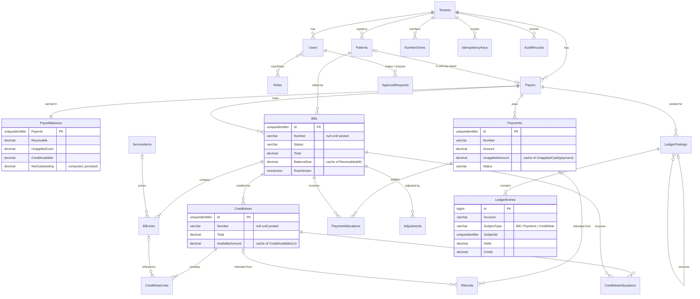

# Database

- **Status:** R1 schema designed 2026-09-29. Implemented incrementally by EF Core migrations in
  `src/BillingRecon.Infrastructure`; this document is the target the migrations converge on.
- **Engine:** SQL Server 2022 (Docker locally, Testcontainers in tests). One database, one schema
  (`dbo`), one application login.
- **Rules cited:** BR-nnn from `requirements.md`; ADRs 0003–0010.

---

## 1. Conventions

| Concern | Convention |
|---|---|
| Names | Tables plural PascalCase (`Bills`, `BillLines`). Columns PascalCase. `PK_<Table>`, `FK_<Table>_<Column>`, `IX_<Table>_<Cols>`, `UX_` unique, `CK_<Table>_<Rule>`. |
| Primary keys | Aggregates and documents: `Id uniqueidentifier`, generated client-side by EF's sequential GUID generator, clustered. Append-only tables (`LedgerEntries`, `AuditRecords`): `Id bigint IDENTITY`, clustered, so insertion order is the physical order. Junction and cache tables: composite or borrowed keys. |
| Tenancy | Every tenant-scoped table has `TenantId uniqueidentifier NOT NULL` with an FK to `Tenants`, `FK_<Table>_TenantId`, added by a convention of the context. It is the **first column of every non-clustered index** and every unique index; a model that breaks this fails to build (`TenantLeadingIndexConvention`). EF creates no index per foreign key of its own accord: each table declares the indexes it needs, tenant first. EF applies a global query filter `TenantId == current`, a save interceptor sets it on inserts and rejects mismatches, and `TenantId` is part of the WHERE clause of every UPDATE and DELETE (BR-002, ADR 0009, ADR 0015). |
| Money | `decimal(18,2)` for every amount (BR-001). `decimal(19,4)` unit prices, `decimal(9,3)` quantities, `decimal(5,2)` percentages. The value objects `Money`, `UnitPrice`, `Quantity` and `Percent` get these columns from a convention of the context (ADR 0004, ADR 0015); any other decimal needs an explicit precision and scale in its configuration, and one without them fails the EF model, which stops the API at startup, the tests and the EF tools (ADR 0015). |
| Instants | `datetimeoffset(3)`, always stored with offset `+00:00`; the `…AtUtc` suffix says so. Read from `IClock.UtcNow` only (BR-003, ADR 0010). |
| Business dates | `date`, IST calendar dates; suffix `…Date` (BR-003). Fiscal year as `char(7)` label `2026-27` (BR-004). |
| Enums and codes | `varchar(n)` with a `CHECK (col IN (...))`. Readable in SQL and in exports; EF maps enums as strings. For an enum the constraint `CK_<Table>_<Column>` is generated from the enum's members, so adding a value is a migration that replaces the CHECK (ADR 0015). |
| Text | `nvarchar(n)` for user-entered text; `varchar(n)` for ASCII codes and references. A text column without a length fails the EF model, like an unsized decimal. No `nvarchar(max)` except JSON and response bodies, which are marked `IsUnbounded()` in their configuration (ADR 0015). |
| Concurrency | `RowVersion rowversion NOT NULL` on every mutable aggregate root, mapped as an EF concurrency token (BR-804, ADR 0007). Child rows (`BillLines`) and caches updated set-based (`PayerBalances`) carry none. |
| Deletes | No `ON DELETE CASCADE` anywhere: every foreign key is `ON DELETE NO ACTION`, set by a convention of the context whatever a configuration says (ADR 0015). The application login has no `DELETE` permission on any table except `IdempotencyKeys` and `BillLines`, the lines of draft bills (BR-005, §7, ADR 0019), and the context refuses to delete a row of any other entity. Reference data is deactivated by `Status`/`IsActive`. |
| Append-only | `LedgerPostings`, `LedgerEntries`, `AuditRecords`: `INSERT`/`SELECT` only for the application login (BR-402, BR-702). |
| Nulls | Nullable only where "absent" is meaningful (unposted number, optional reference). Every other column `NOT NULL`. |
| Defaults | Only for `RowVersion`, `bit` flags, zero balances and identity columns. Application code sets everything else explicitly: where a table below says "initially", the value is set by the aggregate's factory method, not by the database. |
| Audit columns | **Stamp** (who created the row, when) on every table that has them, **Touch** (who changed it last, when) on mutable tables only; append-only tables have Stamp only. Both are filled by a save interceptor, never by application code; the user is null for system work (seeding, migrations, background jobs). They are not the audit trail, which is `AuditRecords` (ADR 0015). |

---

## 2. Entity–relationship diagram



---

## 3. Tables

Column tables list `Type`, `Null` (`•` = nullable) and notes. Common columns are abbreviated:

- **T** = `TenantId uniqueidentifier NOT NULL`, FK `Tenants(Id)`.
- **Stamp** = `CreatedAtUtc datetimeoffset(3) NOT NULL`, `CreatedByUserId uniqueidentifier •` FK `Users(Id)`; null when no user did it (ADR 0015).
- **Touch** = `UpdatedAtUtc datetimeoffset(3) NOT NULL`, `UpdatedByUserId uniqueidentifier •` FK `Users(Id)`; equal to Stamp on a new row. Every mutable table that has Stamp also has Touch, added in the migration that creates the table, even where the table below does not list it yet.
- **RV** = `RowVersion rowversion NOT NULL`.
- **Posted** = `PostedAtUtc datetimeoffset(3) •`, `PostedByUserId uniqueidentifier •` FK `Users(Id)`.
- **Voided** = `VoidedAtUtc datetimeoffset(3) •`, `VoidedByUserId uniqueidentifier •`, `VoidReason nvarchar(500) •`.
- **Doc#** = `Number varchar(30) •`, `FiscalYear char(7) •`, `SequenceNumber int •` — all three null until posted, all three set at posting; `Number = Prefix + '/' + <short fiscal year, e.g. 26-27> + '/' + RIGHT('000000' + SequenceNumber, 6)`, at most 16 characters (ADR 0008).

### 3.1 Identity

**Tenants** — the row *is* the tenant: a tenant reads, updates and deletes its own row only, system work (no
tenant in scope) sees every row (ADR 0015 §3). Settings per BR-607. Migration `0001_Tenants`.
No Stamp or Touch: a tenant is created by platform onboarding before any of its users exists, so the
table has `CreatedAtUtc` only, set by `Tenant.Create`; changes to its settings are in `AuditRecords`.

| Column | Type | Null | Notes |
|---|---|---|---|
| Id | uniqueidentifier | | PK |
| Code | varchar(20) | | `UX_Tenants_Code`; slug for logs and URLs: lower-case letters, digits and single hyphens (checked by `Tenant.Create`) |
| Name | nvarchar(200) | | |
| Status | varchar(20) | | `CK_Tenants_Status`: `Active`, `Suspended` |
| PostingApprovalThreshold | decimal(18,2) | • | null = bills never need approval (BR-207) |
| MaxBackdateDays | int | | initially 7; `CK_Tenants_MaxBackdateDays` 0–365 (BR-205) |
| DefaultDueDays | int | | initially 0; `CK_Tenants_DefaultDueDays` 0–365 (BR-205) |
| BillPrefix, CreditNotePrefix, PaymentPrefix, AdjustmentPrefix, RefundPrefix | varchar(3) | | initially `BIL`, `CN`, `PAY`, `ADJ`, `REF`; one CHECK per column (`CK_Tenants_BillPrefix`, …): 1–3 characters `[A-Z0-9]`, compared with a binary collation so that lower-case letters are refused (BR-802, ADR 0008) |
| CreatedAtUtc | datetimeoffset(3) | | |
| RowVersion | rowversion | | |

**Users**

| Column | Type | Null | Notes |
|---|---|---|---|
| Id | uniqueidentifier | | PK |
| T | | | |
| Email | nvarchar(256) | | as entered |
| NormalizedEmail | nvarchar(256) | | upper-cased; `UX_Users_TenantId_NormalizedEmail` (BR-601) |
| DisplayName | nvarchar(200) | | |
| PasswordHash | nvarchar(500) | | PBKDF2 via the static `Rfc2898DeriveBytes.Pbkdf2` (BCL; the class's constructors are obsolete from .NET 10); format `alg$iterations$salt$hash` |
| Status | varchar(20) | | CK `Active`, `Disabled` |
| CreatedAtUtc | datetimeoffset(3) | | |
| LastSignInAtUtc | datetimeoffset(3) | • | |
| RowVersion | rowversion | | |

**Roles** — global, seeded by migration: `TenantAdmin`, `Supervisor`, `BillingClerk`, `Cashier`, `Viewer`.

| Column | Type | Null | Notes |
|---|---|---|---|
| Code | varchar(30) | | PK |
| Name | nvarchar(100) | | |

**UserRoles**

| Column | Type | Null | Notes |
|---|---|---|---|
| UserId | uniqueidentifier | | PK part, FK `Users` |
| RoleCode | varchar(30) | | PK part, FK `Roles` |
| T | | | denormalised so the tenant filter applies |
| GrantedAtUtc | datetimeoffset(3) | | |
| GrantedByUserId | uniqueidentifier | | FK `Users` |

**Built 2026-11-21 (Prompt 5.1, ADR 0030; migration `0018_Users`).** The three tables are as above, with these
precisions.

- `Users`: tenant-scoped, so with `FK_Users_TenantId`; `PasswordHash` is `varchar(500)` (the text is ASCII: the
  algorithm, the iterations, and salt and hash in base64), kept out of every audit image; Stamp and Touch as on every
  mutable table (`CreatedAtUtc`, `CreatedByUserId`, `UpdatedAtUtc`, `UpdatedByUserId`, the user columns keys to
  `Users` itself); `CK_Users_Status`; `UX_Users_TenantId_NormalizedEmail`. `LastSignInAtUtc` stays null until sign-in
  (Prompt 5.2).
- `Roles`: `CK_Roles_Code` lists the five codes; the rows are written from the model (`HasData`), not by a
  hand-written statement. The tests' reset leaves the table alone.
- `UserRoles`: `PK_UserRoles (UserId, RoleCode)`, `CK_UserRoles_RoleCode`, `FK_UserRoles_UserId`,
  `FK_UserRoles_RoleCode`, `FK_UserRoles_GrantedByUserId`, `FK_UserRoles_TenantId`, and
  `IX_UserRoles_TenantId_RoleCode` (the administrators of a tenant). A role taken away is deleted: the key from the role
  to its user is the third client-cascading key of the model (ON DELETE NO ACTION in the database), after the lines of
  draft bills and draft credit notes.
- **Every earlier column that names a user is now a foreign key to `Users`** (ADR 0021 point 1, ADR 0030 point 1): 34
  keys `FK_<Table>_<Column>` added by `0018`, on the stamps of every mutable table, the posted, voided, allocated and
  reversed by of the documents, the maker and checker of `ApprovalRequests`, and `UserId` of `AuditRecords` and
  `IdempotencyKeys`.

**PrefixChanges** (BR-802, BR-604; ADR 0033) — a TenantAdmin's request for a new prefix of one document type, decided
by a second person through its approval request (document type `PrefixChange`, action `ChangePrefix`). Built with
migration `0019_PrefixChanges` (Prompt 5.3b).

| Column | Type | Null | Notes |
|---|---|---|---|
| Id | uniqueidentifier | | PK |
| T | | | `FK_PrefixChanges_TenantId` |
| DocumentType | varchar(20) | | `CK_PrefixChanges_DocumentType`: the five types that take a number |
| FromPrefix, ToPrefix | varchar(3) | | the prefix when asked and the one to get; `CK_PrefixChanges_FromPrefix`, `CK_PrefixChanges_ToPrefix` as every prefix column; `CK_PrefixChanges_ChangesThePrefix` (they differ) |
| Status | varchar(20) | | `CK_PrefixChanges_Status`: `Pending`, `Approved`, `Rejected`; `UX_PrefixChanges_TenantId_DocumentType_Pending (TenantId, DocumentType) WHERE Status = 'Pending'`: one change waits per type |
| DecidedAtUtc | datetimeoffset(3) | • | `CK_PrefixChanges_Decided`: null exactly while pending |
| Stamp, Touch | | | `CreatedAtUtc` is when it was asked for, `CreatedByUserId` the maker; keys to `Users` |
| RowVersion | rowversion | | |

`IX_PrefixChanges_TenantId_CreatedAtUtc` serves the list, the newest first. The same migration adds two checks to
**Tenants**: `CK_Tenants_PrefixesDistinct` (the five default prefixes differ from each other) and
`CK_Tenants_PostingApprovalThreshold` (null, or above zero); and it renames the unused value `NumberSeries` of
`CK_ApprovalRequests_DocumentType` to `PrefixChange`. An approved change also sets `Prefix` of the type's
`NumberSeries` row of the current fiscal year, through the model and its row version (section 3.6), when that row
exists; section 4.4 checks the one case where it can be missed.

### 3.2 Payers

Migration `0002_SyncCurrentModel` (Prompt 2.2, ADR 0018; the name it was scaffolded under, §8). Both tables are tenant-scoped: `FK_Patients_TenantId` and
`FK_Payers_TenantId` refer to `Tenants`, and every index leads with `TenantId` (§1). Text is stored without its
surrounding white space, and a blank optional value as null; the limits of the columns are checked by the validators
of the use cases first.

**Patients**

| Column | Type | Null | Notes |
|---|---|---|---|
| Id | uniqueidentifier | | PK |
| T | | | `FK_Patients_TenantId` |
| Mrn | nvarchar(30) | | As entered, no control characters. `UX_Patients_TenantId_Mrn` (BR-101); under the database's case-insensitive collation, MRNs that differ only in case are the same MRN, as the `Mrn` value object says |
| FullName | nvarchar(200) | | `IX_Patients_TenantId_FullName` |
| DateOfBirth | date | • | not in the future, not before 1900 (validator) |
| Sex | varchar(10) | • | `CK_Patients_Sex`: `Male`, `Female`, `Other`, `Unknown` |
| Phone | nvarchar(20) | • | |
| Email | nvarchar(256) | • | |
| AddressLine1, AddressLine2 | nvarchar(200) | • | |
| City, State | nvarchar(100) | • | |
| PinCode | varchar(10) | • | ASCII letters, digits, spaces and hyphens: an Indian PIN code or a foreign postal code |
| Status | varchar(20) | | `CK_Patients_Status`: `Active`, `Inactive` (BR-102) |
| Stamp, Touch, RV | | | `CreatedByUserId` and `UpdatedByUserId` get their FK to `Users` with the Users migration |

**Payers**

| Column | Type | Null | Notes |
|---|---|---|---|
| Id | uniqueidentifier | | PK |
| T | | | `FK_Payers_TenantId` |
| Kind | varchar(20) | | `CK_Payers_Kind`: `SelfPay`, `Insurer`, `Corporate`, generated from the enum (ADR 0015). Only `SelfPay` is ever written in R1: the aggregate refuses the others (BR-103) |
| Name | nvarchar(200) | | `IX_Payers_TenantId_Name` |
| PatientId | uniqueidentifier | • | `FK_Payers_PatientId` to `Patients(Id)`; `UX_Payers_TenantId_PatientId WHERE [PatientId] IS NOT NULL` (BR-104), which also serves the FK. Null for a guarantor. Never changes |
| Phone | nvarchar(20) | • | |
| Email | nvarchar(256) | • | |
| Status | varchar(20) | | `CK_Payers_Status`: `Active`, `Inactive` (BR-105) |
| Stamp, Touch, RV | | | |

`FK_Payers_PatientId` does not include the tenant: a payer naming another tenant's patient is prevented by the use case
(its lookup of the patient is filtered by the tenant), not by the database. Whether to make such keys composite is an
open question (ADR 0015, built note of 2026-10-17).

### 3.3 Billing

**ServiceItems** — chargemaster, reference data. Migration `0003_ServiceItems` (Prompt 2.3). Tenant-scoped:
`FK_ServiceItems_TenantId` refers to `Tenants`, and both indexes lead with `TenantId` (§1).

| Column | Type | Null | Notes |
|---|---|---|---|
| Id | uniqueidentifier | | PK |
| T | | | `FK_ServiceItems_TenantId` |
| Code | varchar(30) | | As entered: ASCII letters, digits and `. - _ /`. `UX_ServiceItems_TenantId_Code`; under the database's case-insensitive collation, codes that differ only in case are the same code, as the `ServiceItemCode` value object says. Never changes |
| Name | nvarchar(200) | | `IX_ServiceItems_TenantId_Name` |
| Category | nvarchar(50) | • | free text |
| DefaultUnitPrice | decimal(19,4) | | `CK_ServiceItems_DefaultUnitPrice`: `>= 0` (BR-201) |
| TaxRatePercent | decimal(5,2) | | `CK_ServiceItems_TaxRatePercent`: `BETWEEN 0 AND 100` (BR-201). The property is `TaxRate` |
| Status | varchar(20) | | `CK_ServiceItems_Status`: `Active`, `Inactive`, generated from the enum (ADR 0015). It replaces the `IsActive bit` of the first design, so that patients, payers and service items are deactivated the same way |
| Stamp, Touch, RV | | | The table is mutable, so it has Touch as well |

**Bills**

| Column | Type | Null | Notes |
|---|---|---|---|
| Id | uniqueidentifier | | PK |
| T | | | |
| Doc# | | • | `UX_Bills_TenantId_Number WHERE Number IS NOT NULL`; `UX_Bills_TenantId_FiscalYear_SequenceNumber WHERE SequenceNumber IS NOT NULL` (BR-801, gapless check in §4.3) |
| PatientId | uniqueidentifier | | FK `Patients`; `IX_Bills_TenantId_PatientId` |
| PayerId | uniqueidentifier | | FK `Payers`; `IX_Bills_TenantId_PayerId_Status INCLUDE (BalanceDue, Total)` |
| BillDate | date | | `IX_Bills_TenantId_BillDate` |
| | | | Since migration `0028_DocumentSearch` (Prompt 11.1): `IX_Bills_TenantId_Total`, and on the other documents `IX_CreditNotes_TenantId_Total`, `IX_Payments_TenantId_Amount`, `IX_Adjustments_TenantId_Amount`, `IX_Refunds_TenantId_Amount`: the search of a list by an exact amount (ADR 0036, amended 2026-11-26) |
| DueDate | date | | CK `DueDate >= BillDate` (BR-205) |
| EncounterReference | nvarchar(50) | • | HIS visit / admission id, free text |
| Notes | nvarchar(1000) | • | |
| Status | varchar(20) | | CK `Draft`, `PendingApproval`, `Posted`, `PartiallyPaid`, `Settled`, `Voided`; `IX_Bills_TenantId_Status WHERE Status = 'PendingApproval'` |
| SubTotal, DiscountTotal, TaxTotal, Total | decimal(18,2) | | CK each ≥ 0; CK `Total = SubTotal - DiscountTotal + TaxTotal` (BR-203) |
| BalanceDue | decimal(18,2) | | CK `BalanceDue BETWEEN 0 AND Total` (BR-405). Drafts carry `BalanceDue = Total`. Cache of `Receivable(bill)` (§5.5). |
| UpdatedAtUtc | datetimeoffset(3) | | set on every command, so `RowVersion` changes even when only a line changed (ADR 0007) |
| Stamp, Posted, Voided, RV | | | |

Additional checks:

- `CK_Bills_NumberIffPosted`: `(Status IN ('Draft','PendingApproval','Voided') AND Number IS NULL AND PostedAtUtc IS NULL) OR (Status IN ('Posted','PartiallyPaid','Settled') AND Number IS NOT NULL AND PostedAtUtc IS NOT NULL)` (BR-206).
- `CK_Bills_StatusMatchesBalance`: `(Status <> 'Posted' OR (BalanceDue = Total AND Total > 0)) AND (Status <> 'PartiallyPaid' OR (BalanceDue > 0 AND BalanceDue < Total)) AND (Status <> 'Settled' OR BalanceDue = 0)` (BR-208).
- `CK_Bills_VoidedIffVoided`: a voided bill has `VoidedAtUtc` and `VoidReason`; any other bill has neither, and no
  `VoidedByUserId`. Written as two alternatives joined by `OR`, because SQL Server has no equality of conditions.

**Built so far: migration `0004_Bills` (Prompt 2.4, ADR 0019), the table as drafts need it.** The table above is the
target; the migration creates this part of it, and the posting slices add the rest by migration, with the code that
sets it:

- *In the table now:* `Id`, T, `PatientId`, `PayerId`, `BillDate`, `DueDate`, `EncounterReference`, `Notes`,
  `Status`, the four totals, `BalanceDue`, Voided (`VoidedAtUtc`, `VoidedByUserId`, `VoidReason nvarchar(500)`),
  Stamp, Touch, RV.
- *Constraints now:* `CK_Bills_Status` with `Draft` and `Voided` only (generated from the enum, which has no other
  member yet); `CK_Bills_DueDate`; `CK_Bills_SubTotal`, `CK_Bills_DiscountTotal`, `CK_Bills_TaxTotal` (each `>= 0`);
  `CK_Bills_Total` (`>= 0` and the identity of BR-203); `CK_Bills_BalanceDue`; `CK_Bills_VoidedIffVoided`;
  `FK_Bills_TenantId`, `FK_Bills_PatientId`, `FK_Bills_PayerId`.
- *Indexes now:* `IX_Bills_TenantId_PatientId`, `IX_Bills_TenantId_PayerId_Status INCLUDE (BalanceDue, Total)`,
  `IX_Bills_TenantId_BillDate`.
- *Added by migration `0009_BillPosting` (Prompt 3.5, ADR 0022):* Doc# as `Number varchar(16)` (the length of
  CGST rule 46, ADR 0008), `FiscalYear char(7)` and `SequenceNumber int`; Posted (`PostedAtUtc`, `PostedByUserId`);
  the two filtered unique indexes; `CK_Bills_NumberIffPosted`, `CK_Bills_StatusMatchesBalance`, and
  `CK_Bills_NumberParts` (the three parts of the number are all there or all absent, and a bill without a number
  has no poster). `CK_Bills_Status` lists `Draft`, `Voided`, `Posted`, `PartiallyPaid` and `Settled` from
  `0004_Bills` on, because it is generated from the enum and both migrations were scaffolded after the enum grew.
- *Added by migration `0010_Approvals` (Prompt 3.6, ADR 0023):* the filtered index of the bills that wait,
  `IX_Bills_TenantId_Status WHERE Status = 'PendingApproval'`. The status itself is in `CK_Bills_Status` from
  `0004_Bills` on, for the reason given above, and `CK_Bills_NumberIffPosted` named it already.
- `UpdatedAtUtc` is not set by the aggregate: when only lines changed, the unit of work marks it as modified, the
  audit stamp writes it, and the UPDATE checks and advances `RowVersion` (ADR 0019).

**BillLines** — owned by `Bills`; no rowversion (the bill's covers it), no Stamp or Touch. Built with `0004_Bills`
as listed here. `UX_BillLines_TenantId_BillId_LineNo` leads with the tenant, like every index of a tenant-scoped
table (§1), and replaces the `UX_BillLines_BillId_LineNo` of the first design. `FK_BillLines_BillId` is
`ON DELETE NO ACTION` like every key; a line taken out of a draft is deleted by Entity Framework, never by the
database (ADR 0019). Constraint names: `CK_BillLines_LineNo` (`>= 1`), `CK_BillLines_Quantity`,
`CK_BillLines_UnitPrice`, `CK_BillLines_LineAmount`, `CK_BillLines_DiscountAmount`, `CK_BillLines_TaxRatePercent`,
`CK_BillLines_TaxAmount`, `CK_BillLines_LineTotal`; `FK_BillLines_TenantId`, `FK_BillLines_BillId`,
`FK_BillLines_ServiceItemId`.

| Column | Type | Null | Notes |
|---|---|---|---|
| Id | uniqueidentifier | | PK |
| T | | | |
| BillId | uniqueidentifier | | FK `Bills` |
| LineNo | int | | `UX_BillLines_BillId_LineNo` |
| ServiceItemId | uniqueidentifier | • | FK `ServiceItems` |
| Description | nvarchar(300) | | |
| Quantity | decimal(9,3) | | CK > 0 (BR-201) |
| UnitPrice | decimal(19,4) | | CK ≥ 0 |
| LineAmount | decimal(18,2) | | CK ≥ 0; = round(Quantity × UnitPrice) in code (BR-202) |
| DiscountAmount | decimal(18,2) | | CK `DiscountAmount BETWEEN 0 AND LineAmount` |
| TaxRatePercent | decimal(5,2) | | CK 0–100 |
| TaxAmount | decimal(18,2) | | CK ≥ 0 |
| LineTotal | decimal(18,2) | | CK `LineTotal = LineAmount - DiscountAmount + TaxAmount` |

The multiplication and rounding (`LineAmount`, `TaxAmount`) are not CHECKed: SQL Server's `ROUND`
semantics differ from `MidpointRounding.AwayFromZero` in edge cases and the domain is the single
implementation of BR-202. The additive identities are CHECKed.

**CreditNotes**

| Column | Type | Null | Notes |
|---|---|---|---|
| Id | uniqueidentifier | | PK |
| T | | | |
| Doc# | | • | `UX_CreditNotes_TenantId_Number` and `UX_CreditNotes_TenantId_FiscalYear_SequenceNumber`, both filtered |
| BillId | uniqueidentifier | | FK `Bills`; `IX_CreditNotes_TenantId_BillId_Status INCLUDE (Total)` (BR-210 cap query) |
| PayerId | uniqueidentifier | | FK `Payers`; must equal the bill's payer (checked in code); `IX_CreditNotes_TenantId_PayerId_Status INCLUDE (AvailableAmount)` |
| PatientId | uniqueidentifier | | FK `Patients` |
| CreditNoteDate | date | | CK against bill date is in code (BR-214) |
| Reason | nvarchar(500) | | |
| Status | varchar(20) | | CK `Draft`, `PendingApproval`, `Posted`, `Voided` |
| SubTotal, DiscountTotal, TaxTotal, Total | decimal(18,2) | | same CKs as Bills |
| AvailableAmount | decimal(18,2) | | CK `AvailableAmount BETWEEN 0 AND Total` (BR-213). Cache of `CreditAvailable(creditNote)`. Drafts: `= Total`. |
| UpdatedAtUtc | datetimeoffset(3) | | as for Bills (ADR 0007) |
| Stamp, Posted, Voided, RV | | | `CK_CreditNotes_NumberIffPosted` as for Bills with `Status = 'Posted'` |

**CreditNoteLines** — as `BillLines` with `CreditNoteId` FK `CreditNotes`, `UX_CreditNoteLines_CreditNoteId_LineNo`, plus:

| Column | Type | Null | Notes |
|---|---|---|---|
| BillLineId | uniqueidentifier | • | FK `BillLines`; `IX_CreditNoteLines_TenantId_BillLineId INCLUDE (LineTotal)` for the BR-211 cap |

**CreditNoteAllocations** — application of a credit note's available credit to a bill (BR-212, BR-213).

| Column | Type | Null | Notes |
|---|---|---|---|
| Id | uniqueidentifier | | PK |
| T | | | |
| CreditNoteId | uniqueidentifier | | FK `CreditNotes`; `IX_CreditNoteAllocations_TenantId_CreditNoteId` |
| BillId | uniqueidentifier | | FK `Bills`; `IX_CreditNoteAllocations_TenantId_BillId INCLUDE (Amount, Status)` |
| Amount | decimal(18,2) | | CK > 0 |
| Status | varchar(20) | | CK `Active`, `PendingReversal`, `Reversed` |
| AllocatedAtUtc | datetimeoffset(3) | | |
| AllocatedByUserId | uniqueidentifier | | FK `Users` |
| AppliedAtPosting | bit | | The application to its own bill made by the approval of the credit note (BR-212); never reversed (ADR 0028). `CK_CreditNoteAllocations_AtPostingStaysActive`: `AppliedAtPosting = 0 OR Status = 'Active'` |
| PostingId | uniqueidentifier | | FK `LedgerPostings`: the paired entry |
| ReversedAtUtc | datetimeoffset(3) | • | CK `(Status = 'Reversed') = (ReversedAtUtc IS NOT NULL)` |
| ReversedByUserId | uniqueidentifier | • | the checker |
| ReversalReason | nvarchar(500) | • | |
| ReversalPostingId | uniqueidentifier | • | FK `LedgerPostings`: the mirror entry |

**Built 2026-11-21 (Prompt 4.3, ADR 0025; migration `0013_CreditNotes`).** The three tables are as above, with
these precisions.

- `CreditNotes`: `Number` is `varchar(16)` with `FiscalYear`, `SequenceNumber`, `PostedAtUtc` and `PostedByUserId`,
  null until the credit note is posted, as on `Bills`; `Reason` and `VoidReason` are `nvarchar(500)`. The
  constraints: `CK_CreditNotes_SubTotal`, `_DiscountTotal`, `_TaxTotal`, `_Total`, `_AvailableAmount`, `_Status`,
  `_VoidedIffVoided`, `_NumberParts`, and `CK_CreditNotes_NumberIffPosted`, which also says that a posted credit
  note comes to more than nothing (`Total > 0`). The indexes named above, plus
  `IX_CreditNotes_TenantId_PatientId`. `FK_CreditNotes_BillId`, `_PayerId` and `_PatientId` come from the typed-id
  convention (ADR 0021).
- `CreditNoteLines`: the columns and CHECK constraints of `BillLines` under the names `CK_CreditNoteLines_*`,
  without `ServiceItemId`; `BillLineId` with `FK_CreditNoteLines_BillLineId` and the index named above;
  `UX_CreditNoteLines_TenantId_CreditNoteId_LineNo`. `FK_CreditNoteLines_CreditNoteId` is `ClientCascade` in the
  model, `NO ACTION` in the database: a line taken out of a draft is deleted by Entity Framework.
- `CreditNoteAllocations`: the columns down to `PostingId` (`NOT NULL`), without `AppliedAtPosting`;
  `AllocatedByUserId` is null when no user acted and has no key until `Users` exists; no reversal column, and
  `CK_CreditNoteAllocations_Status` allows `Active` alone. No row version: the credit note's covers its lines and
  its applications.
- *Added by migration `0016_CreditApplicationReversals` (Prompt 4.5b, ADR 0028):* `AppliedAtPosting bit NOT NULL
  DEFAULT 0` (existing rows count as later applications: ADR 0028, point 9), `ReversedAtUtc`, `ReversedByUserId`
  (no key until `Users` exists, like `AllocatedByUserId`), `ReversalReason nvarchar(500)` and `ReversalPostingId`
  with `FK_CreditNoteAllocations_ReversalPostingId`; `CK_CreditNoteAllocations_Status` dropped and created again
  with `Active`, `PendingReversal` and `Reversed`; `CK_CreditNoteAllocations_ReversedIffReversed` (the four reversal
  columns are all set when the status is `Reversed` and all null otherwise) and
  `CK_CreditNoteAllocations_AtPostingStaysActive`.

### 3.4 Payments

**Payments** — posted at creation, so `Number`, `FiscalYear`, `SequenceNumber` are `NOT NULL` (BR-302).

| Column | Type | Null | Notes |
|---|---|---|---|
| Id | uniqueidentifier | | PK |
| T | | | |
| Number | varchar(30) | | `UX_Payments_TenantId_Number` |
| FiscalYear | char(7) | | |
| SequenceNumber | int | | `UX_Payments_TenantId_FiscalYear_SequenceNumber` |
| PayerId | uniqueidentifier | | FK `Payers`; `IX_Payments_TenantId_PayerId_Status INCLUDE (UnappliedAmount)` |
| PaymentDate | date | | `IX_Payments_TenantId_PaymentDate INCLUDE (Method, Amount, Status)` (daily collection, BR-901) |
| Method | varchar(20) | | CK `Cash`, `Card`, `UPI`, `BankTransfer`, `Cheque` (BR-301) |
| Reference | nvarchar(100) | • | CK `Method = 'Cash' OR Reference IS NOT NULL` (BR-301) |
| Amount | decimal(18,2) | | CK > 0 |
| UnappliedAmount | decimal(18,2) | | CK `UnappliedAmount BETWEEN 0 AND Amount` (BR-405). Cache of `UnappliedCash(payment)`. |
| Status | varchar(20) | | CK `Posted`, `PendingReversal`, `Reversed`; CK `Status <> 'Reversed' OR UnappliedAmount = 0` (BR-306) |
| Notes | nvarchar(500) | • | |
| PostingId | uniqueidentifier | | FK `LedgerPostings` |
| ReversedAtUtc | datetimeoffset(3) | • | CK `(Status = 'Reversed') = (ReversedAtUtc IS NOT NULL)` |
| ReversedByUserId | uniqueidentifier | • | the checker |
| ReversalReason | nvarchar(500) | • | |
| ReversalPostingId | uniqueidentifier | • | FK `LedgerPostings` |
| Stamp, RV | | | `CreatedAtUtc` is the posting instant |

**Built 2026-11-20 (Prompt 4.1; migration `0011_Payments`), as recording needs it.** The table has the columns
above down to `PostingId`, the audit stamp and the row version; the four reversal columns, the statuses
`PendingReversal` and `Reversed` and the two CHECK constraints that speak of them are **not** there yet and arrive
with reversals (Prompt 4.5), so `CK_Payments_Status` allows `Posted` alone for now. Precisions: `Number` is
`varchar(16)`, the length of a document number, as on `Bills`; the constraints are `CK_Payments_SequenceNumber`
(`>= 1`), `CK_Payments_Amount`, `CK_Payments_UnappliedAmount`, `CK_Payments_Reference`, `CK_Payments_Method` and
`CK_Payments_Status`; `FK_Payments_PayerId` and `FK_Payments_PostingId` come from the typed-id convention
(ADR 0021), no cascade. `PostingId` is `NOT NULL`: the ledger port answers the id of the posting it entered, and
the payment is saved with it in the same commit.

**PaymentAllocations** — same shape as `CreditNoteAllocations` with `PaymentId` FK `Payments`
(`IX_PaymentAllocations_TenantId_PaymentId`, `IX_PaymentAllocations_TenantId_BillId INCLUDE (Amount, Status)`).
The rule "payment and bill share a payer" (BR-303) is cross-table and enforced in code; the
reconciliation query in §5.6 also detects a violation.

**Built 2026-11-21 (Prompt 4.5, ADR 0027; migration `0015_PaymentReversals`).** `Payments` and `PaymentAllocations`
each gained `ReversedAtUtc` `datetimeoffset(3)`, `ReversedByUserId` (the checker; no key until `Users` exists),
`ReversalReason` `nvarchar(500)` and `ReversalPostingId`, all null unless the row is reversed, with
`FK_Payments_ReversalPostingId` and `FK_PaymentAllocations_ReversalPostingId` from the typed-id convention.
`CK_Payments_ReversedIffReversed` and `CK_PaymentAllocations_ReversedIffReversed` say that the four columns are
set exactly when the status is `Reversed`; the first also says that a reversed payment has nothing unapplied
(BR-306). They stand in for the two constraints of the table above that speak of reversal. `CK_Payments_Status`
now allows `Posted`, `PendingReversal` and `Reversed`, and `CK_PaymentAllocations_Status` `Active`,
`PendingReversal` and `Reversed`; both lists are in `0011` and `0012` already, because the constraints are
generated from the enums. No row is ever deleted by a reversal.

**Built 2026-11-20 (Prompt 4.2, ADR 0024; migration `0012_PaymentAllocations`), as allocating needs it.** The
columns: `Id`, `TenantId`, `PaymentId`, `BillId`, `Amount` `decimal(18,2)`, `Status` `varchar(20)`, `AllocatedAtUtc`
`datetimeoffset(3)`, `AllocatedByUserId` (null when no user acted), `PostingId` `NOT NULL`. There is **no row
version**: an allocation is a child of its payment, whose version covers it. The constraints are
`CK_PaymentAllocations_Amount` (`> 0`) and `CK_PaymentAllocations_Status`, which allows `Active` alone for now; the
reversal columns and the statuses `PendingReversal` and `Reversed` arrive with reversals (Prompt 4.5). Four foreign
keys, no cascade: `FK_PaymentAllocations_TenantId`, `FK_PaymentAllocations_PaymentId` (declared with the
relationship), and `FK_PaymentAllocations_BillId` and `FK_PaymentAllocations_PostingId` from the typed-id convention
(ADR 0021). The two indexes are the ones named above.

**Refunds**

| Column | Type | Null | Notes |
|---|---|---|---|
| Id | uniqueidentifier | | PK |
| T | | | |
| Doc# | | • | filtered unique indexes as for Bills |
| PayerId | uniqueidentifier | | FK `Payers`; `IX_Refunds_TenantId_PayerId` |
| SourceKind | varchar(20) | | CK `Payment`, `CreditNote` (BR-307) |
| SourcePaymentId | uniqueidentifier | • | FK `Payments`; `IX_Refunds_TenantId_SourcePaymentId INCLUDE (Amount, Status)` |
| SourceCreditNoteId | uniqueidentifier | • | FK `CreditNotes`; `IX_Refunds_TenantId_SourceCreditNoteId INCLUDE (Amount, Status)` |
| RefundDate | date | | |
| Amount | decimal(18,2) | | CK > 0 |
| Method | varchar(20) | | CK as Payments |
| Reference | nvarchar(100) | • | CK `Method = 'Cash' OR Reference IS NOT NULL` |
| Reason | nvarchar(500) | | |
| Status | varchar(20) | | CK `Draft`, `PendingApproval`, `Posted`, `Voided` |
| PostingId | uniqueidentifier | • | FK `LedgerPostings`; set at posting |
| Stamp, Posted, Voided, RV | | | |

`CK_Refunds_OneSource`: `(SourceKind = 'Payment' AND SourcePaymentId IS NOT NULL AND SourceCreditNoteId IS NULL) OR (SourceKind = 'CreditNote' AND SourceCreditNoteId IS NOT NULL AND SourcePaymentId IS NULL)`.

**Built 2026-11-21 (Prompt 4.6, ADR 0029; migration `0017_Refunds`).** The table is as above, with these
precisions. Doc# is `Number varchar(16)`, `FiscalYear char(7)`, `SequenceNumber int`, with Posted (`PostedAtUtc`,
`PostedByUserId`), all null until the refund is posted; Voided is `VoidedAtUtc`, `VoidedByUserId`, `VoidReason
nvarchar(500)`; Stamp, Touch and RV as on `Adjustments`. The constraints: `CK_Refunds_Amount`, `_Reference`,
`_OneSource`, `_SourceKind`, `_Method` and `_Status` (the last three generated from the enums), `_VoidedIffVoided`,
`_NumberIffPosted` (which also ties `PostingId` to the posted state) and `_NumberParts`. The indexes:
`IX_Refunds_TenantId_PayerId`, `IX_Refunds_TenantId_SourcePaymentId INCLUDE (Amount, Status)` (what the reversal of a
payment asks, BR-306), `IX_Refunds_TenantId_SourceCreditNoteId INCLUDE (Amount, Status)`, and the two filtered unique
indexes of the number. `FK_Refunds_TenantId`, `_PayerId`, `_SourcePaymentId`, `_SourceCreditNoteId` and `_PostingId`
come from the typed-id convention (ADR 0021). Nothing on `Payments` or `CreditNotes` changes: what a refund took is
in their `UnappliedAmount` and `AvailableAmount`, and identities 4 and 5 sum the posted refunds.

### 3.5 Adjustments

**Adjustments**

| Column | Type | Null | Notes |
|---|---|---|---|
| Id | uniqueidentifier | | PK |
| T | | | |
| Doc# | | • | filtered unique indexes as for Bills |
| BillId | uniqueidentifier | | FK `Bills`; `IX_Adjustments_TenantId_BillId_Status INCLUDE (Amount)` |
| PayerId | uniqueidentifier | | FK `Payers` |
| AdjustmentDate | date | | |
| Kind | varchar(20) | | CK `Discount`, `WriteOff`, `Rounding` (BR-501) |
| Amount | decimal(18,2) | | CK `Amount > 0 AND (Kind <> 'Rounding' OR Amount < 1.00)` |
| Reason | nvarchar(500) | | NOT NULL (BR-502) |
| Status | varchar(20) | | CK `Draft`, `PendingApproval`, `Posted`, `Voided` |
| PostingId | uniqueidentifier | • | FK `LedgerPostings` |
| Stamp, Posted, Voided, RV | | | |

**Built 2026-11-21 (Prompt 4.4, ADR 0026; migration `0014_Adjustments`).** The table is as above, with these
precisions. `Number` is `varchar(16)` with `FiscalYear`, `SequenceNumber`, `PostedAtUtc` and `PostedByUserId`, null
until the adjustment is posted; `Reason` and `VoidReason` are `nvarchar(500)`. The constraints:
`CK_Adjustments_Amount` (above zero, and under 1.00 for a rounding), `CK_Adjustments_Kind`, `CK_Adjustments_Status`,
`CK_Adjustments_VoidedIffVoided`, `CK_Adjustments_NumberParts`, and `CK_Adjustments_NumberIffPosted`, which ties the
number, the posted stamp and `PostingId` to the status `Posted`. The indexes: the one named above,
`IX_Adjustments_TenantId_PayerId`, and the two filtered unique indexes of the number. `FK_Adjustments_BillId`,
`_PayerId` and `_PostingId` come from the typed-id convention (ADR 0021). There is no reversal column: a posted
adjustment is not reversed.

### 3.6 Common: approvals, number series, idempotency

**ApprovalRequests** (BR-603 – BR-606)

| Column | Type | Null | Notes |
|---|---|---|---|
| Id | uniqueidentifier | | PK |
| T | | | |
| DocumentType | varchar(30) | | CK `Bill`, `CreditNote`, `Adjustment`, `Refund`, `Payment`, `PaymentAllocation`, `CreditNoteAllocation`, `PrefixChange` (it was `NumberSeries`, unused, until `0019`; ADR 0033) |
| DocumentId | uniqueidentifier | | no FK (polymorphic); `UX_ApprovalRequests_TenantId_DocumentType_DocumentId WHERE Status = 'Pending'` (BR-605) |
| Action | varchar(30) | | CK `Post`, `Reverse`, `ChangePrefix` |
| MakerUserId | uniqueidentifier | | FK `Users` |
| MakerComment | nvarchar(500) | • | |
| CheckerUserId | uniqueidentifier | • | FK `Users`; CK `CheckerUserId IS NULL OR CheckerUserId <> MakerUserId` (BR-603) |
| CheckerComment | nvarchar(500) | • | |
| Status | varchar(20) | | CK `Pending`, `Approved`, `Rejected`; CK `(Status = 'Pending') = (CheckerUserId IS NULL AND DecidedAtUtc IS NULL)`; `IX_ApprovalRequests_TenantId_Status_RequestedAtUtc` |
| RequestedAtUtc | datetimeoffset(3) | | |
| DecidedAtUtc | datetimeoffset(3) | • | |
| CorrelationId | uniqueidentifier | | of the request that opened it |
| RowVersion | rowversion | | |

**Built 2026-11-20 (Prompt 3.6, ADR 0023; migration `0010_Approvals`), as above with these precisions.**
`CK_ApprovalRequests_CheckerIsNotMaker` is the check on the checker. The rule of the status is written as two
alternatives, `CK_ApprovalRequests_Decided`: pending with no checker and no decision instant, or decided with both.
`CK_ApprovalRequests_RejectionHasComment` adds that a rejected request has the checker's comment (BR-605).
`MakerUserId` and `CheckerUserId` have no foreign key until `Users` exists (Prompt 5.1). The first document type in
use is `Bill` with the action `Post`; the other values of the two CHECK constraints are there for Phase 4.

**NumberSeries** (BR-801, BR-802, ADR 0008)

| Column | Type | Null | Notes |
|---|---|---|---|
| Id | uniqueidentifier | | PK |
| T | | | |
| DocumentType | varchar(20) | | CK `Bill`, `CreditNote`, `Payment`, `Adjustment`, `Refund` |
| FiscalYear | char(7) | | `UX_NumberSeries_TenantId_DocumentType_FiscalYear` — the row that is locked |
| Prefix | varchar(3) | | CK 1–3 characters `[A-Z0-9]` (ADR 0008) |
| NextNumber | int | | CK ≥ 1; never decreased |
| CreatedAtUtc, UpdatedAtUtc | datetimeoffset(3) | | |
| RowVersion | rowversion | | for prefix edits only; the number path uses the lock in §4 |

Built with migration `0005_NumberSeries` (Prompt 3.1) as listed: `FK_NumberSeries_TenantId`,
`CK_NumberSeries_DocumentType` (generated from the enum), `CK_NumberSeries_Prefix` (the same expression as the
tenant's default prefixes, binary collation), `CK_NumberSeries_NextNumber`, and the one index,
`UX_NumberSeries_TenantId_DocumentType_FiscalYear`. The table has no Stamp or Touch user columns: a series is
created and advanced by the statement of §4.1, which no user edits, and the two instants are set there from the
clock. Since `0019_PrefixChanges` (ADR 0033) an approved prefix change also sets `Prefix` and `UpdatedAtUtc` of the
series of the current fiscal year, through the model; its audit records name the maker and the checker.
`FiscalYear` is the value object, stored as its label by a convention of the context.

**IdempotencyKeys** (BR-803, ADR 0006) — clustered on the lookup key; the only table the application login may `DELETE` from (expiry sweep).

| Column | Type | Null | Notes |
|---|---|---|---|
| TenantId | uniqueidentifier | | PK part |
| Key | uniqueidentifier | | PK part |
| UserId | uniqueidentifier | | |
| Method | varchar(8) | | |
| Path | nvarchar(400) | | |
| RequestHash | binary(32) | | SHA-256 of method + path + body bytes |
| Status | varchar(12) | | CK `InProgress`, `Completed` |
| StatusCode | int | • | set at completion |
| ResponseContentType | varchar(100) | • | |
| ResponseHeaders | nvarchar(1000) | • | JSON: `Location`, `ETag` |
| ResponseBody | nvarchar(max) | • | |
| CreatedAtUtc | datetimeoffset(3) | | |
| CompletedAtUtc | datetimeoffset(3) | • | |
| ExpiresAtUtc | datetimeoffset(3) | | `IX_IdempotencyKeys_ExpiresAtUtc`; 30 days |

Built with migration `0006_IdempotencyKeys` (Prompt 3.2; ADR 0006, "Built 2026-11-20"), with these differences from
the table above:

- `UserId` is nullable until the Identity slice: a request without a user leaves it null, like the audit columns.
- The index is `IX_IdempotencyKeys_TenantId_ExpiresAtUtc`: tenant first, like every index of a tenant-scoped table
  (§1). The sweep of expired keys therefore goes tenant by tenant.
- `RequestHash` covers more than the note says: the method, the path with its query string, the `If-Match` header
  and the body bytes.
- `PK_IdempotencyKeys` is `(TenantId, Key)`, clustered; `FK_IdempotencyKeys_TenantId`; `CK_IdempotencyKeys_Status`
  (generated from the enum); and `CK_IdempotencyKeys_Completed`: a completed key has `StatusCode`,
  `CompletedAtUtc` and `ResponseBody`, a key in progress has none of them.
- `ResponseBody` is the body as text (the API answers in UTF-8 JSON); an answer without a body is stored as an
  empty text.
- Not the only table with a `DELETE` any more: `BillLines` has one too (§7, ADR 0019).

### 3.7 Receivables

**LedgerPostings** — one row per financial event; append-only (BR-401, BR-402).

| Column | Type | Null | Notes |
|---|---|---|---|
| Id | uniqueidentifier | | PK; generated by the application so document rows can reference it in the same transaction |
| T | | | |
| PostedAtUtc | datetimeoffset(3) | | |
| BusinessDate | date | | the document's date (BR-406); `IX_LedgerPostings_TenantId_BusinessDate` |
| Kind | varchar(30) | | CK `BillPosted`, `PaymentRecorded`, `PaymentAllocated`, `AllocationReversed`, `PaymentReversed`, `CreditNotePosted`, `CreditApplied`, `CreditApplicationReversed`, `AdjustmentPosted`, `RefundPosted` |
| DocumentType | varchar(30) | | CK `Bill`, `Payment`, `PaymentAllocation`, `CreditNote`, `CreditNoteAllocation`, `Adjustment`, `Refund` |
| DocumentId | uniqueidentifier | | `IX_LedgerPostings_TenantId_DocumentType_DocumentId` |
| PayerId | uniqueidentifier | | FK `Payers`; `IX_LedgerPostings_TenantId_PayerId` |
| ReversalOfPostingId | uniqueidentifier | • | FK `LedgerPostings`; set on the four `…Reversed` kinds |
| Description | nvarchar(300) | | e.g. `Bill BIL/26-27/000123 posted` |
| PostedByUserId | uniqueidentifier | | FK `Users` |
| CorrelationId | uniqueidentifier | | |

**LedgerEntries** — the lines; append-only.

| Column | Type | Null | Notes |
|---|---|---|---|
| Id | bigint IDENTITY | | PK clustered |
| T | | | |
| PostingId | uniqueidentifier | | FK `LedgerPostings` |
| LineNo | smallint | | `UX_LedgerEntries_PostingId_LineNo` |
| Account | varchar(20) | | CK `Receivable`, `UnappliedCash`, `CreditAvailable`, `Revenue`, `Cash`, `Adjustments` (BR-403) |
| SubjectType | varchar(20) | • | CK `Bill`, `Payment`, `CreditNote` |
| SubjectId | uniqueidentifier | • | `IX_LedgerEntries_TenantId_SubjectType_SubjectId INCLUDE (Account, Debit, Credit)` |
| PayerId | uniqueidentifier | • | FK `Payers`; `IX_LedgerEntries_TenantId_PayerId_Account INCLUDE (Debit, Credit)` |
| Debit | decimal(18,2) | | default 0; CK ≥ 0 |
| Credit | decimal(18,2) | | default 0; CK ≥ 0 |

Checks:

- `CK_LedgerEntries_OneSide`: `(Debit > 0 AND Credit = 0) OR (Debit = 0 AND Credit > 0)`.
- `CK_LedgerEntries_Subject`:
  `(Account = 'Receivable' AND SubjectType = 'Bill' AND SubjectId IS NOT NULL AND PayerId IS NOT NULL)
  OR (Account = 'UnappliedCash' AND SubjectType = 'Payment' AND SubjectId IS NOT NULL AND PayerId IS NOT NULL)
  OR (Account = 'CreditAvailable' AND SubjectType = 'CreditNote' AND SubjectId IS NOT NULL AND PayerId IS NOT NULL)
  OR (Account IN ('Revenue','Cash','Adjustments') AND SubjectType IS NULL AND SubjectId IS NULL AND PayerId IS NULL)` (BR-403).

"Debits equal credits per posting" spans rows and is not a CHECK. It is asserted by
`IReceivablesLedger` before the insert and by the reconciliation query in §5.6; there are no triggers.

**PayerBalances** — cache row per payer, created with the payer (BR-404).

| Column | Type | Null | Notes |
|---|---|---|---|
| PayerId | uniqueidentifier | | PK, FK `Payers` |
| T | | | |
| Receivable | decimal(18,2) | | default 0; CK ≥ 0 — Σ `BalanceDue` of the payer's bills |
| UnappliedCash | decimal(18,2) | | default 0; CK ≥ 0 — Σ `UnappliedAmount` of the payer's payments |
| CreditAvailable | decimal(18,2) | | default 0; CK ≥ 0 — Σ `AvailableAmount` of the payer's credit notes |
| NetOutstanding | AS (Receivable - UnappliedCash - CreditAvailable) PERSISTED | | what the payer owes net of money we hold for them |
| LastPostingId | uniqueidentifier | • | FK `LedgerPostings` |
| UpdatedAtUtc | datetimeoffset(3) | | |

No rowversion: updated with `UPDATE PayerBalances SET Receivable += @d … WHERE PayerId = @p` inside
the posting transaction, so concurrent postings for one payer queue on the row lock instead of
failing with 409 (see `domain-model.md` §6).

**Built 2026-11-20 (Prompt 3.3, ADR 0005 built note, ADR 0021), as above with these differences.**
`LedgerPostings.PostedByUserId` is nullable and has no foreign key until `Users` exists (Prompt 5.1), like every
other user column. `PayerBalances` has no `LastPostingId`: the balances are changed before the posting row is
inserted, so the key could not hold at that moment. The unique index of `LedgerEntries` leads with the tenant, like
every index of a tenant-scoped table: `UX_LedgerEntries_TenantId_PostingId_LineNo`. `Debit` and `Credit` have no
default: the application always writes both. The foreign keys to `Payers` (`FK_LedgerPostings_PayerId`,
`FK_LedgerEntries_PayerId`, `FK_PayerBalances_PayerId`) and `FK_LedgerPostings_ReversalOfPostingId` come from the
typed-id convention of the context, not from the entity configurations. The row of `PayerBalances` is opened at
zero by the use case that creates the payer, through the Receivables port `IPayerAccounts`; migration
`0008_Receivables` opens it for every payer that existed before, with one hand-written statement. A posting changes
the row with one batch: a read under `UPDLOCK, ROWLOCK`, then the change.

### 3.8 Audit

**AuditRecords** — insert-only (BR-701, BR-702).

| Column | Type | Null | Notes |
|---|---|---|---|
| Id | bigint IDENTITY | | PK clustered |
| T | | | |
| OccurredAtUtc | datetimeoffset(3) | | `IX_AuditRecords_TenantId_OccurredAtUtc` |
| UserId | uniqueidentifier | • | null for system actions (migrations, expiry sweep) |
| CorrelationId | uniqueidentifier | | `IX_AuditRecords_TenantId_CorrelationId` (BR-703) |
| EntityType | varchar(50) | | e.g. `Bill`, `Payment`, `User`, `Tenant` |
| EntityId | uniqueidentifier | | `IX_AuditRecords_TenantId_EntityType_EntityId_Id` |
| DocumentNumber | varchar(30) | • | for human lookup |
| Action | varchar(40) | | e.g. `Created`, `Posted`, `Voided`, `Allocated`, `ApprovalGranted`, `RolesChanged` |
| BeforeJson | nvarchar(max) | • | null on create |
| AfterJson | nvarchar(max) | • | null never (state after the change) |
| Reason | nvarchar(500) | • | void, reversal, rejection reason |

**Built 2026-11-20 (Prompt 3.4, ADR 0020), as above with these precisions.** `AfterJson` is `NOT NULL`. `Id` is
the one key in the model that is not a typed Guid id. `EntityType` is the name of the aggregate's class and
`Action` the name of the domain event without it (`Registered`, `Updated`, `Deactivated`, `Reactivated`, `Created`,
`Drafted`, `HeaderUpdated`, `LinesReplaced`, `Voided` so far). The two images hold the stored row, one member per
column, and the children of the aggregate (a bill's `Lines`); the row version and the tenant are left out.
`DocumentNumber` stays null until documents have numbers (Prompt 3.5). The third index ends in `Id`, so the trail
of one record is read in the order it was written. Rows are written by the unit of work in the transaction of the
change and refused for update and delete by `AppendOnlyGuardInterceptor`; the grants of section 7 are still to come.

---

## 4. Gapless number series (ADR 0008)

### 4.1 Allocation inside the posting transaction

Run by `INumberSeries.NextAsync` on the **same connection and transaction** as the document insert,
after all validation, as the last step before writing the document (BR-801):

```sql
-- @tenant, @type ('Bill'), @fy ('2026-27'), @defaultPrefix from Tenants

DECLARE @next int, @prefix varchar(3);

SELECT @next = NextNumber, @prefix = Prefix
FROM   dbo.NumberSeries WITH (UPDLOCK, HOLDLOCK)
WHERE  TenantId = @tenant AND DocumentType = @type AND FiscalYear = @fy;

IF @next IS NULL
BEGIN
    -- first document of this type in this fiscal year: create the row under the same range lock
    INSERT dbo.NumberSeries (Id, TenantId, DocumentType, FiscalYear, Prefix, NextNumber, CreatedAtUtc, UpdatedAtUtc)
    VALUES (NEWID(), @tenant, @type, @fy, @defaultPrefix, 1, @now, @now);
    SET @next = 1; SET @prefix = @defaultPrefix;
END

UPDATE dbo.NumberSeries
SET    NextNumber = @next + 1, UpdatedAtUtc = @now
WHERE  TenantId = @tenant AND DocumentType = @type AND FiscalYear = @fy;

SELECT @next AS SequenceNumber,
       @prefix + '/' + SUBSTRING(@fy, 3, 5) + '/' + RIGHT('000000' + CAST(@next AS varchar(6)), 6) AS Number;
       -- '2026-27' -> '26-27': BIL/26-27/000123 is 16 characters (ADR 0008)
```

- `UPDLOCK` takes an update lock on the row so two posting transactions for the same series
  serialise; the second waits, then reads the incremented value.
- `HOLDLOCK` (serializable) holds a **range** lock when the row does not exist yet, so two
  first-of-year postings cannot both insert; the loser blocks and then finds the row.
- The lock is released only at commit or rollback. A rollback leaves `NextNumber` unchanged, so a
  failed posting consumes no number.
- An equivalent single-statement form, `UPDATE … SET NextNumber += 1 OUTPUT deleted.NextNumber`,
  is acceptable for the existing-row path; the create-on-first-use path still needs the range lock.

**As built (Prompt 3.1, `NumberSeriesAllocator`, ADR 0008 "Built 2026-11-20"):**

- The statement above is sent as one batch with four parameters (`@tenant`, `@type`, `@fiscalYear`, `@now`). The
  default prefix is not a parameter: when the row has to be created, the batch reads it from the tenant's own row
  (`BillPrefix`, `CreditNotePrefix` and so on, by `@type`). A tenant without a row gets no series and no number.
- The batch returns the sequence number and the prefix; the number is formatted in the application by
  `DocumentNumber`, which refuses a number longer than 16 characters. The allocator then fails and the increment
  rolls back: a number a tax invoice may not carry is never issued.
- "The same connection and transaction": `NextAsync` opens a transaction on the request's context if none is open,
  and the unit of work commits it with the save, or rolls it back.
- **A new series can wait for a neighbour.** The range lock of `HOLDLOCK` covers the gap in the unique index where
  the new row will go, up to the next row. If that next row is a series with a posting in flight, another tenant's
  included, the first posting of the new series waits until that posting ends. Once per series, for milliseconds,
  without a deadlock (a use case locks one series). An existing series locks its own row only.
- This was the one raw SQL statement of the application; every other raw-SQL entry point of EF Core is a build
  error (`src/BannedSymbols.txt`). The ledger and the reconciliation have one each since Prompt 3.3 (ADR 0021), and
  the dashboard's ledger movements two since Prompt 6.3 (section 5.7, ADR 0037).
- **The hold of an approved prefix change** (ADR 0033, "Amended 2026-11-23"): `INumberSeries.HoldAsync` sends the
  first `SELECT` above alone, in the approval's transaction, after its checks and before it reads the tenant and the
  series. It locks the row, or the gap where the row will go, until the approval commits, and takes no number. A
  number and an approval so take the series first and the tenant row second, in the same order: a number in flight
  finishes first and the approval changes the series it created; a first number asked for during the approval waits,
  then starts from the new default. Like a first number, a hold of a series that does not exist yet may wait for a
  neighbour (above).

### 4.2 Fiscal year

`@fy` comes from `FiscalYear.FromDate(document business date)` (BR-004), not from today's date. A
bill dated 31 March 2027 posted on 2 April 2027 takes the next `2026-27` number.

### 4.3 Gapless verification query

Run in integration tests after every scenario and available as a report:

```sql
SELECT TenantId, FiscalYear, COUNT(*) AS Documents, MAX(SequenceNumber) AS MaxSeq
FROM   dbo.Bills
WHERE  SequenceNumber IS NOT NULL
GROUP  BY TenantId, FiscalYear
HAVING COUNT(*) <> MAX(SequenceNumber);   -- any row = a gap or a duplicate
```

The same query runs against `CreditNotes`, `Payments`, `Adjustments` and `Refunds`.

*Built 2026-11-23 (Prompt 6.2, ADR 0036 amendment):* the check is part of the reconciliation (section 5.6), as identity
11, `NumberSeriesGap`: for each series of the tenant, the documents numbered from it must be as many as their highest
number, and that number the one before the series' `NextNumber`. So it is in the reconciliation report and in the check
that runs after every database test.

### 4.4 Prefix of the current series (ADR 0033)

The series of today's fiscal year carries the tenant's default prefix of its type: both are set together when a
prefix change is approved, and a series created later starts from the default. Until 2026-11-23 there was one
exception, the race of ADR 0033 (built note point 5): the first number of a type in a year, taken in the milliseconds
of an approval, created the series with the old prefix. The approval now holds the series first (§4.1, "The hold of an
approved prefix change"), so this query should find nothing; a row is a series created before that change, or a
defect:

```sql
DECLARE @fy char(7) = '2026-27';   -- today's fiscal year, by the date in India
SELECT s.TenantId, s.DocumentType, s.Prefix AS SeriesPrefix
FROM   dbo.NumberSeries s
JOIN   dbo.Tenants t ON t.Id = s.TenantId
WHERE  s.FiscalYear = @fy
AND    s.Prefix <> CASE s.DocumentType
                       WHEN 'Bill' THEN t.BillPrefix
                       WHEN 'CreditNote' THEN t.CreditNotePrefix
                       WHEN 'Payment' THEN t.PaymentPrefix
                       WHEN 'Adjustment' THEN t.AdjustmentPrefix
                       WHEN 'Refund' THEN t.RefundPrefix
                   END;
```

No test runs it after every scenario; the tests of the hold (`SettingsApiTests`, `NumberSeriesOnSqlServerTests`) check
the series against the default after an approval. A row is repaired through the API: one more change of that type, or
two to come back to the prefix that was asked for.

---

## 5. Receivables ledger

### 5.1 Scope

A **subledger**, not a general ledger (ADR 0005). It answers "what does each payer owe, on which
bill, and what do we hold for them?" with double-entry discipline, and it is the source of truth for
every balance in the system. Revenue, Cash and Adjustments are **control accounts** that make every
posting balance and let R5 export journals to an external accounting system; they carry no subject.

### 5.2 Accounts and sign convention

| Account | Normal side | Subject | Balance formula | Meaning of a positive balance |
|---|---|---|---|---|
| `Receivable` | Debit | Bill | Σ Debit − Σ Credit | the payer still owes this on the bill |
| `UnappliedCash` | Credit | Payment | Σ Credit − Σ Debit | money received, not yet applied to a bill |
| `CreditAvailable` | Credit | Credit note | Σ Credit − Σ Debit | credit granted, not yet applied or refunded |
| `Revenue` | Credit | — | Σ Credit − Σ Debit | net billed (bills less credit notes) |
| `Cash` | Debit | — | Σ Debit − Σ Credit | net money received (payments less refunds and reversals) |
| `Adjustments` | Debit | — | Σ Debit − Σ Credit | balances given up without money (discounts, write-offs, rounding) |
| `OpeningBalances` | Credit | — | Σ Credit − Σ Debit | what the hospital carried over from the system before: the opening receivables less the opening advances (ADR 0053). Only an approved opening batch posts to it |

Every entry has one positive `Debit` or one positive `Credit`, never both, never negative
(`CK_LedgerEntries_OneSide`). "Increase what the payer owes" is always a **debit to `Receivable`**;
"increase what we hold for the payer" is always a **credit to `UnappliedCash` or `CreditAvailable`**.

### 5.3 Posting templates

`Dr` / `Cr` amounts are `decimal(18,2)` already rounded at the document (BR-001). Each row is one
`LedgerPosting`; a use case may create more than one posting (credit note posting creates two).

| Kind | Trigger | Entries | Cache deltas |
|---|---|---|---|
| `BillPosted` | Bill posted, total *T* | Dr `Receivable(bill)` T · Cr `Revenue` T | `Bill.BalanceDue = T`; `Payer.Receivable += T` |
| `PaymentRecorded` | Payment recorded, amount *P* | Dr `Cash` P · Cr `UnappliedCash(payment)` P | `Payment.UnappliedAmount = P`; `Payer.UnappliedCash += P` |
| `PaymentAllocated` | Allocation, amount *A* | **Dr `UnappliedCash(payment)` A · Cr `Receivable(bill)` A** | `Payment.UnappliedAmount −= A`; `Bill.BalanceDue −= A`; `Payer.UnappliedCash −= A`; `Payer.Receivable −= A` |
| `AllocationReversed` | Allocation reversal approved | Dr `Receivable(bill)` A · Cr `UnappliedCash(payment)` A; `ReversalOfPostingId` = the allocation's posting | the mirror of the above |
| `PaymentReversed` | Payment reversal approved, amount *P* | one `AllocationReversed` per active allocation, then Dr `UnappliedCash(payment)` P · Cr `Cash` P | `Payment.UnappliedAmount = 0`; `Payer.UnappliedCash −= P` |
| `CreditNotePosted` | Credit note posted, total *C* | Dr `Revenue` C · Cr `CreditAvailable(creditNote)` C | `CreditNote.AvailableAmount = C`; `Payer.CreditAvailable += C` |
| `CreditApplied` | Auto-apply at posting or explicit apply, amount *X* | **Dr `CreditAvailable(creditNote)` X · Cr `Receivable(bill)` X** | `CreditNote.AvailableAmount −= X`; `Bill.BalanceDue −= X`; `Payer.CreditAvailable −= X`; `Payer.Receivable −= X` |
| `CreditApplicationReversed` | Application reversal approved | Dr `Receivable(bill)` X · Cr `CreditAvailable(creditNote)` X | the mirror |
| `AdjustmentPosted` | Adjustment posted, amount *D* | Dr `Adjustments` D · Cr `Receivable(bill)` D | `Bill.BalanceDue −= D`; `Payer.Receivable −= D` |
| `RefundPosted` | Refund posted, amount *R* | Dr `UnappliedCash(payment)` **or** `CreditAvailable(creditNote)` R · Cr `Cash` R | source cache `−= R`; `Payer.UnappliedCash` or `Payer.CreditAvailable` `−= R` |
| `OpeningReceivablePosted` | Opening batch approved, an unpaid bill of the system before, outstanding *O* (ADR 0053) | Dr `Receivable(bill)` O · Cr `OpeningBalances` O, dated the day before the cut-over | `Bill.BalanceDue = O`; `Payer.Receivable += O` |
| `OpeningAdvancePosted` | Opening batch approved, an advance or credit balance of the system before, amount *V* (ADR 0053) | Dr `OpeningBalances` V · Cr `UnappliedCash(payment)` V, dated the day before the cut-over | `Payment.UnappliedAmount = V`; `Payer.UnappliedCash += V` |

### 5.4 The paired-entry treatment of allocations

An allocation moves value between two subject accounts of the **same payer** and touches no control
account: `Dr UnappliedCash(payment) / Cr Receivable(bill)`. Consequences:

- The payer's `NetOutstanding` is unchanged by an allocation (receivable falls by *A*, unapplied
  cash falls by *A*). Allocation is bookkeeping about *which bill* the money settles, not about
  *whether* the payer paid. This is why a payment with unapplied cash already reduces what the
  payer owes net.
- Both subject balances change by the same amount in one posting, which is why the use case must
  update both `Payment.UnappliedAmount` and `Bill.BalanceDue` in one transaction
  (`domain-model.md` §6). Splitting them would break identity 4 and 5 below between commits.
- Reversal is the mirror pair with `ReversalOfPostingId` set; the original posting is never edited.
- Worked example. Bill `BIL/26-27/000042` for ₹5,000; payment `PAY/26-27/000017` of ₹3,000 by UPI;
  allocate ₹3,000: `Receivable(bill)` 5,000 → 2,000, `UnappliedCash(payment)` 3,000 → 0, bill becomes
  `PartiallyPaid`, payer net outstanding stays ₹2,000 before and after the allocation.
- *Built 2026-11-20 (Prompt 4.2, ADR 0024).* One request may name up to 50 bills; each gets its own posting, and
  all of them commit together or not at all. The order of the locks: nothing is locked while the request is
  checked; the first posting takes the update lock on the payer's row of `PayerBalances` and holds it to the commit;
  the save then writes the payment and the bills, each under its row version. Every request that writes a bill of
  the payer holds that one lock first, so the rows of the bills are never waited for in two orders.
  A posting that would take a cached balance of the payer below zero is refused under that lock
  (`ledger_balance_negative`), before the CHECK constraint of the table could fail the batch.

### 5.5 Balance identities (BR-404)

These hold after **every** committed transaction. Integration tests assert all of them after each
scenario; the reconciliation report evaluates them on demand.

| # | Identity |
|---|---|
| 1 | For every `LedgerPostings` row: `Σ Debit = Σ Credit` over its entries, and the posting has ≥ 2 entries. |
| 2 | Every posted document (`Bills` with `Number`, `Payments`, posted `CreditNotes`, `Adjustments`, `Refunds`, and every allocation row) has exactly one `LedgerPostings` row with its `DocumentType`/`DocumentId` (plus one reversal posting if reversed); every `LedgerPostings` row has such a document. *Amended 2026-11-20 (ADR 0022):* a posted bill whose total is zero has no posting and is not counted here. |
| 3 | `Bills.BalanceDue = Σ(Debit − Credit)` over `LedgerEntries` where `Account = 'Receivable' AND SubjectId = Bills.Id`, for every posted bill. Equivalently: `Total − Σ active PaymentAllocations − Σ active CreditNoteAllocations − Σ posted Adjustments`. |
| 4 | `Payments.UnappliedAmount = Σ(Credit − Debit)` over `UnappliedCash` entries for the payment. Equivalently: `Amount − Σ active allocations − Σ posted refunds from it`, and `0` if reversed. |
| 5 | `CreditNotes.AvailableAmount = Σ(Credit − Debit)` over `CreditAvailable` entries for the credit note. Equivalently: `Total − Σ active applications − Σ posted refunds from it`. |
| 6 | `PayerBalances.Receivable = Σ Bills.BalanceDue` for the payer's posted bills `= Σ(Debit − Credit)` over the payer's `Receivable` entries. |
| 7 | `PayerBalances.UnappliedCash = Σ Payments.UnappliedAmount` for the payer `= Σ(Credit − Debit)` over the payer's `UnappliedCash` entries. |
| 8 | `PayerBalances.CreditAvailable = Σ CreditNotes.AvailableAmount` for the payer `= Σ(Credit − Debit)` over the payer's `CreditAvailable` entries. |
| 9 | Tenant trial balance: `Receivable + Cash + Adjustments (debit balances) = Revenue + UnappliedCash + CreditAvailable (credit balances)`, summed over all entries of the tenant. |
| 10 | No subject balance is negative (identities 3, 4, 5 each ≥ 0) and `BalanceDue ≤ Total`, `UnappliedAmount ≤ Amount`, `AvailableAmount ≤ Total` (BR-405). |
| 11 | Gapless: for each (tenant, document type, fiscal year), `COUNT(*) = MAX(SequenceNumber)` and `NumberSeries.NextNumber = MAX(SequenceNumber) + 1` (§4.3). |
| 12 | *Since ADR 0053:* the balance of `OpeningBalances` (`Σ Credit − Σ Debit`) `= Σ Bills.Total` of the opening receivables `− Σ Payments.Amount` of the opening advances. Nothing but an approved opening batch posts to the account. And identity 11 counts bills and payments **by origin**: the opening receivables against the series `OpeningReceivable`, the opening advances against `OpeningAdvance`, the rest against `Bill` and `Payment`; identity 2 looks for the posting kind of a document's origin. |

### 5.6 Reconciliation queries

Each query returns **zero rows** when the identity holds. They run per tenant.

```sql
-- Identity 3: bill balance versus ledger
SELECT b.Id, b.Number, b.BalanceDue, ISNULL(l.Balance, 0) AS LedgerBalance
FROM   dbo.Bills b
LEFT JOIN (
    SELECT SubjectId, SUM(Debit - Credit) AS Balance
    FROM   dbo.LedgerEntries
    WHERE  TenantId = @tenant AND Account = 'Receivable'
    GROUP  BY SubjectId) l ON l.SubjectId = b.Id
WHERE  b.TenantId = @tenant AND b.Number IS NOT NULL
  AND  b.BalanceDue <> ISNULL(l.Balance, 0);

-- Identity 4: payment unapplied versus ledger
SELECT p.Id, p.Number, p.UnappliedAmount, ISNULL(l.Balance, 0) AS LedgerBalance
FROM   dbo.Payments p
LEFT JOIN (
    SELECT SubjectId, SUM(Credit - Debit) AS Balance
    FROM   dbo.LedgerEntries
    WHERE  TenantId = @tenant AND Account = 'UnappliedCash'
    GROUP  BY SubjectId) l ON l.SubjectId = p.Id
WHERE  p.TenantId = @tenant AND p.UnappliedAmount <> ISNULL(l.Balance, 0);

-- Identity 6–8: payer cache versus ledger
SELECT pb.PayerId, pb.Receivable, pb.UnappliedCash, pb.CreditAvailable,
       l.Receivable AS LedgerReceivable, l.UnappliedCash AS LedgerUnapplied, l.CreditAvailable AS LedgerCredit
FROM   dbo.PayerBalances pb
LEFT JOIN (
    SELECT PayerId,
           SUM(CASE WHEN Account = 'Receivable'      THEN Debit - Credit ELSE 0 END) AS Receivable,
           SUM(CASE WHEN Account = 'UnappliedCash'   THEN Credit - Debit ELSE 0 END) AS UnappliedCash,
           SUM(CASE WHEN Account = 'CreditAvailable' THEN Credit - Debit ELSE 0 END) AS CreditAvailable
    FROM   dbo.LedgerEntries
    WHERE  TenantId = @tenant AND PayerId IS NOT NULL
    GROUP  BY PayerId) l ON l.PayerId = pb.PayerId
WHERE  pb.TenantId = @tenant
  AND (pb.Receivable <> ISNULL(l.Receivable, 0)
    OR pb.UnappliedCash <> ISNULL(l.UnappliedCash, 0)
    OR pb.CreditAvailable <> ISNULL(l.CreditAvailable, 0));

-- Identity 1: unbalanced postings
SELECT PostingId, SUM(Debit) AS Debits, SUM(Credit) AS Credits, COUNT(*) AS Lines
FROM   dbo.LedgerEntries
WHERE  TenantId = @tenant
GROUP  BY PostingId
HAVING SUM(Debit) <> SUM(Credit) OR COUNT(*) < 2;

-- Identity 2 (one direction): posted bills without a posting
SELECT b.Id, b.Number
FROM   dbo.Bills b
WHERE  b.TenantId = @tenant AND b.Number IS NOT NULL
  AND NOT EXISTS (SELECT 1 FROM dbo.LedgerPostings lp
                  WHERE lp.TenantId = @tenant AND lp.DocumentType = 'Bill' AND lp.DocumentId = b.Id AND lp.Kind = 'BillPosted');

-- BR-303 cross-table rule: allocation between different payers
SELECT a.Id
FROM   dbo.PaymentAllocations a
JOIN   dbo.Payments p ON p.Id = a.PaymentId
JOIN   dbo.Bills    b ON b.Id = a.BillId
WHERE  a.TenantId = @tenant AND p.PayerId <> b.PayerId;
```

*Built 2026-11-20 (Prompt 4.2):* the reconciliation query of the application reports four more identities, each
under its own name: `PaymentAllocations` (a payment's `UnappliedAmount` differs from `Amount − Σ active
allocations`, the second form of identity 4), `AllocationWithoutPosting` and `PostingWithoutAllocation` (identity 2
for allocations, both directions), and `AllocationPayerMismatch` (the BR-303 statement above).

*Built 2026-11-21 (Prompt 4.3):* eight more, for credit notes: `CreditNoteAvailable` (identity 5: the available
amount of a posted credit note differs from its `CreditAvailable` entries), `CreditNoteApplications` (its second
form: `Total − Σ active applications`), `CreditNoteWithoutPosting` and `PostingWithoutCreditNote`,
`ApplicationWithoutPosting` and `PostingWithoutApplication` (identity 2, both directions),
`ApplicationPayerMismatch` (BR-213), and `CreditNotesExceedBillTotal` (BR-210: the posted credit notes of a bill
come to more than the bill).

*Built 2026-11-21 (Prompt 4.4):* three more, for adjustments: `AdjustmentWithoutPosting` and
`PostingWithoutAdjustment` (identity 2, both directions) and `AdjustmentPayerMismatch` (the payer of an adjustment
is not the payer of its bill). What an adjustment took off a bill is already covered by identity 3.

*Built 2026-11-21 (Prompt 4.5):* `PaymentAllocations` (identity 4, second form) now counts an allocation that waits
for its reversal as applied and expects nothing unapplied on a reversed payment. Three more identities:
`ReversedAllocationNoPosting` and `ReversedPaymentNoPosting` (a reversed row without the mirror posting that names
its own posting) and `ReversalPostingNoDocument` (a reversal posting whose allocation or payment is not reversed).

*Built 2026-11-21 (Prompt 4.5b, ADR 0028):* `CreditNoteApplications` counts an application that waits for its
reversal as applied and a reversed one as not. One more identity, `ReversedApplicationNoPosting` (a reversed
application of credit without the mirror posting of kind `CreditApplicationReversed` that names its own posting);
`ReversalPostingNoDocument` also reports a `CreditApplicationReversed` posting whose application is not reversed.

*Built 2026-11-21 (Prompt 4.6, ADR 0029):* the second forms of identities 4 and 5 (`PaymentAllocations`,
`CreditNoteApplications`) subtract the posted refunds of the payment or the credit note, as the table above says.
Three more identities: `RefundWithoutPosting` and `PostingWithoutRefund` (identity 2 for refunds, both directions)
and `RefundPayerMismatch` (a refund whose payer is not the payer of its source).

*Built 2026-11-23 (Prompt 6.2, ADR 0036 amendment):* identity 11, `NumberSeriesGap` (section 4.3). The reconciliation
is the report `GET /api/v1/reports/reconciliation` (US-41, `docs/api.md` section 8.15), which writes an error to the log
when it finds drift, and it runs after every test of the `Database` collection.

A non-empty result is a **Sev-1 defect**: the runbook (section 16.1) says stop postings for the tenant, capture the
rows and the correlation ids from `AuditRecords`, and fix the code path. Caches are never
"corrected" by hand; if a fix requires rebuilding a cache, it is rebuilt from the ledger by a
migration that is itself audited.

### 5.7 The ledger by business date (the dashboard, ADR 0037)

The dashboard (US-44, BR-902) derives its figures of past days from the ledger. `LedgerMovementsQuery`
(Infrastructure.Receivables, behind the Application contract `ILedgerMovements`) sends two constant, read-only
statements, each joining `LedgerEntries` to `LedgerPostings` with `@tenant` in the join and in the WHERE clause:

- **Balances before a date**: Receivable (debit less credit), UnappliedCash and CreditAvailable (credit less debit) of
  every entry whose posting's `BusinessDate` is before `@date`. One row.
- **Movements by business date** from `@from` to `@to`, one row per date that has postings: *billed* (the Receivable
  debits of `BillPosted` postings), *collected* (the Cash debits of `PaymentRecorded` postings, gross of later
  reversals and refunds), and the change of Receivable and of UnappliedCash.

The balance at the end of a day is the balance before the window plus every change up to that day. A posting's
`BusinessDate` is its document's date (the bill date, the payment date) or, for a reversal, the day of its approval.
Both filter on the columns of `IX_LedgerPostings_TenantId_BusinessDate` (no query plan has been looked at yet). `BannedSymbolsTests` pins the file: two suppressions, two
constants, the tenant in both places, nothing that writes.

---

### 5.8 Opening balances (ADR 0053, migration `0023_OpeningBalances`)

Built 2026-11-25 (Prompt 10.3).

- **`Bills` and `Payments`** each gain `Origin nvarchar(20) NOT NULL DEFAULT 'Standard'` (`Standard`, `Opening`; `CK_<Table>_Origin`) and
  `LegacyNumber nvarchar(50) NULL`, the number or reference the document had in the system before, with
  `CK_<Table>_LegacyNumberIffOpening` and the filtered unique index `UX_<Table>_TenantId_LegacyNumber`: an old number is
  brought in once. The default is the one exception to "application code sets everything" besides flags and zero
  balances: every row that existed needs the value. The unique index of a number's position becomes
  `UX_<Table>_TenantId_Origin_FiscalYear_SequenceNumber`, since an opening series starts at 1 beside the standard one.
- **`Payers`** gains `LegacyReference nvarchar(50) NULL`, the reference a guarantor had before, with the filtered unique
  index `UX_Payers_TenantId_LegacyReference`.
- **`OpeningBatches`**: `Id`, `TenantId`, `CutOverDate date`, `ContentHash char(64)` (SHA-256 of the date and the three
  files, upper-case hexadecimal), `BillsCsv`, `AdvancesCsv`, `TrialBalanceCsv` (`nvarchar(max)`, out of every audit image),
  `Receivables int`, `ReceivableTotal decimal(18,2)`, `Advances int`, `AdvanceTotal decimal(18,2)`, `Status nvarchar(20)`
  (`PendingApproval`, `Approved`, `Rejected`), `DecidedAtUtc`, the audit columns and `RowVersion`. CHECKs:
  `CK_OpeningBatches_Counts`, `_Totals`, `_Decided`. Indexes: `UX_OpeningBatches_TenantId_ContentHash WHERE Status <> 'Rejected'`
  and `IX_OpeningBatches_TenantId_CreatedAtUtc`. Keys to `Tenants` and `Users` by the conventions.
- **Enums stored as text** gain values, and their CHECKs with them: `NumberSeries.DocumentType` and
  `PrefixChanges.DocumentType` (`OpeningReceivable`, `OpeningAdvance`), `LedgerPostings.Kind` (the two above),
  `LedgerEntries.Account` (`OpeningBalances`, also among the accounts without a subject in `CK_LedgerEntries_Subject`),
  `ApprovalRequests.DocumentType` (`OpeningBatch`) and `.Action` (`BringForward`).
- **Numbers:** the series of the two opening types are created, like any series, when their first number is taken; their
  prefixes `OBR` and `OBA` are not columns of `Tenants` but the same for every tenant (section 4.1's statement names them).
- **Grants:** `OpeningBatches` takes the schema's `SELECT, INSERT, UPDATE` and nothing more (section 7).

### 5.9 Printed documents (ADR 0054, migration `0024_PrintedDocuments`)

Built 2026-11-25 (Prompt 10.4).

- **`Tenants`** gains the letterhead, ten nullable columns: `LegalName`, `AddressLine1`, `AddressLine2`,
  `Signatory nvarchar(200)`; `City`, `State nvarchar(100)`; `PinCode varchar(10)`; `Phone varchar(20)`;
  `Email nvarchar(256)`; `Gstin char(15)`. They share the row's `RowVersion` with the settings.
- **`ServiceItems`** and **`BillLines`** each gain `SacCode char(6) NULL`: the item's services accounting code, and on a
  line the code its item had when the line was written.
- **`DocumentPrints`**: `Id`, `TenantId`, `DocumentType nvarchar(20)` (`Bill`, `Payment`, `Refund`; the CHECK also admits
  `ShiftClosing` since migration `0030_ShiftClosingSlip`, though no print of a closing slip is recorded), `DocumentId
  uniqueidentifier`, `CopyNumber int` (`CK_DocumentPrints_CopyNumber`: 1 or more), `PrintedAtUtc`, `PrintedByUserId`
  (a key to `Users`). `UX_DocumentPrints_TenantId_DocumentType_DocumentId_CopyNumber` makes the copy numbers of a
  document gapless from 1 and answers how many it has. No key to the document: it is one of three tables.
- **Grants:** `DocumentPrints` is insert-only for the application's role, `DENY UPDATE, DELETE`, written at the end of
  the migration like the ledger's and the audit trail's (section 7).

### 5.10 The images of a letterhead (ADR 0059, migration `0025_LetterheadImages`)

Built 2026-11-26 (Prompt 10.4c).

- **`Tenants`** gains three nullable columns: `SignatoryDesignation nvarchar(200)`, and `LogoSha256` and
  `SignatureSha256 char(64)`, the SHA-256 (lower-case hexadecimal) of the logo and of the signature the hospital
  prints now, null when it has none. They share the row's `RowVersion` with the settings and the letterhead.
- **`TenantImages`**: `Id`, `TenantId`, `Kind varchar(20)` (`Logo`, `Signature`), `Format varchar(10)` (`Png`, `Jpeg`,
  `Webp`), `Content varbinary(max)` (the file as it was uploaded; `CK_TenantImages_Content`: 1 to 262,144 bytes),
  `Sha256 char(64)`, `Width int` and `Height int` (`CK_TenantImages_Width`, `CK_TenantImages_Height`: 1 to 2000),
  `StoredAtUtc`. `UX_TenantImages_TenantId_Kind_Sha256` makes a file a hospital uploads twice one row. No audit
  columns and no row version: a row is written once. No key from `Tenants` to it: the tenant names an image by its
  hash, which the unique index finds.
- **Grants:** `TenantImages` is insert-only for the application's role, `DENY UPDATE, DELETE`, written at the end of
  the migration. An image a hospital replaced or removed stays; only an administrator of the database deletes a row.

### 5.11 Print settings (ADR 0059 as amended, migration `0026_PrintSettings`)

Built 2026-11-26 (Prompt 10.4c-2).

- **`PrintSettings`**: `Id`, `TenantId`, `DocumentType varchar(20)` (`Bill`, `Payment`, `Refund`, and since
  migration `0030_ShiftClosingSlip` (Prompt 11.2b, ADR 0060 amended) `ShiftClosing`, the closing slip of a shift), `Paper varchar(20)`
  (`A4`, `A5`, `Roll80`), `MarginTopMm`, `MarginRightMm`, `MarginBottomMm`, `MarginLeftMm int` (each 5 to 25),
  `LogoPosition varchar(20)` (`Left`, `Centre`, `Right`), `LogoSize varchar(20)` (`Small`, `Medium`, `Large`),
  `PrePrintedStationery bit`, `StationeryTopMm int` (0 to 80), seven `bit` switches (`ShowPatientContact`, `ShowPayer`,
  `ShowSacColumn`, `ShowTaxSplit`, `ShowAmountInWords`, `ShowSignatureBlock`, `ShowCashierName`), `FooterLine
  nvarchar(200) NULL`, `Terms nvarchar(1000) NULL`, the audit columns and `RowVersion`.
  `UX_PrintSettings_TenantId_DocumentType`: at most one row a hospital and kind; no row means the defaults.
- **CHECK constraints** beside those of the enums and the ranges: `CK_PrintSettings_BillPaper` (a bill is not on a
  roll) and `CK_PrintSettings_BillShowsTax` (a bill's `ShowSacColumn` and `ShowTaxSplit` are 1).
- **Grants:** the schema's `SELECT, INSERT, UPDATE`; no line of its own.

### 5.12 The cashier's shift (ADR 0060, migration `0029_CashierShifts`)

A shift of the cash counter and the ledger postings that moved cash in or out of its drawer (BR-310 to BR-315).

- **`CashierShifts`**: `Id`, `TenantId`, `CashierUserId` (FK `Users(Id)`), `BusinessDate date`, `Status varchar(20)`
  (`Open`, `PendingApproval`, `Closed`), `OpeningFloat decimal(18,2)`, `OpenedAtUtc`, `CashDocuments int` (how many
  cash documents joined the shift; each one changes the row version), and, null until the shift is counted:
  `Denominations varchar(120)` (the count as its canonical text, `2000x0 500x12 ... 1x4`), `LooseChange`,
  `CountedCash`, `ExpectedCash` and `Difference` (all `decimal(18,2)`), `DifferenceReason nvarchar(500)`,
  `CountedAtUtc`; `ClosedAtUtc`, the audit columns and `RowVersion`.
- **Indexes:** `UX_CashierShifts_TenantId_CashierUserId_Unclosed` (unique, filtered `[Status] <> 'Closed'`: a user has
  one shift at a time, BR-310) and `IX_CashierShifts_TenantId_BusinessDate` (the day-end report and the list).
- **CHECK constraints** beside that of the enum: `CK_CashierShifts_OpeningFloat` (zero or more),
  `CK_CashierShifts_CashDocuments`, `CK_CashierShifts_LooseChange` (0 to below 1),
  `CK_CashierShifts_CountedIffNotOpen` (an open shift has no count, a counted one all of it),
  `CK_CashierShifts_Difference` (counted less expected), `CK_CashierShifts_ReasonIffDifference`,
  `CK_CashierShifts_PendingHasDifference` (only a difference waits) and `CK_CashierShifts_ClosedIffClosed`.
- **`LedgerPostings.ShiftId uniqueidentifier NULL`**, FK `CashierShifts(Id)` (`FK_LedgerPostings_ShiftId`, by the
  convention of ADR 0021), with `IX_LedgerPostings_TenantId_ShiftId` (filtered `[ShiftId] IS NOT NULL`): the shift
  whose drawer the posting moved cash in or out of; null for every other posting, and for every posting written
  before this migration. A posting that names a shift has the shift's `BusinessDate` (BR-311).
- **The expected cash of a shift (BR-312)** is its float plus
  `SUM(e.Debit - e.Credit)` over `LedgerEntries e JOIN LedgerPostings p ON p.Id = e.PostingId WHERE e.Account = 'Cash'
  AND p.ShiftId = @shift`. The columns `ExpectedCash`, `CountedCash` and `Difference` are what the closing recorded;
  no cash joins a shift once it is counted, so they stay equal to the ledger. A difference is in no ledger entry.
- **`ApprovalRequests`**: `CK_ApprovalRequests_DocumentType` also admits `CashierShift`, and
  `CK_ApprovalRequests_Action` also `Close`.
- **Grants:** `CashierShifts` takes the schema's `SELECT, INSERT, UPDATE`; no line of its own. `LedgerPostings`
  stays insert-only: the column is written with the row.

### 5.13 The second step of a sign-in (ADR 0061, migration `0031_SecondStep`)

Seven columns of `Users`, all null or zero for a user without a second step:

- `SecondStepSecret varchar(200) NULL` and `SecondStepPendingSecret varchar(200) NULL`: the secret of the second step
  and that of an enrolment not confirmed yet, each as `v1.nonce.ciphertext.tag` in base64 (AES-256-GCM under
  `TwoStep:EncryptionKey`, with the tenant's and the user's id as associated data). Never the secret itself.
- `SecondStepLastStep bigint NULL`: the last 30-second step a code was accepted for; that step and every earlier one
  are spent.
- `SecondStepFailures int NOT NULL` (`CK_Users_SecondStepFailures`: zero or more): wrong codes in a row.
- `SecondStepEnrolledAtUtc datetimeoffset(3) NULL`.
- `RecoveryCodeHashes varchar(700) NULL`: the SHA-256 hashes, in hexadecimal and separated by a space, of the
  recovery codes not used yet. Using a code rewrites the column; nothing is deleted.
- `ApprovalHoldUntilUtc datetimeoffset(3) NULL`: until when the user decides nothing, set by an administrator's reset
  of the password or of the second step.

The two secrets and the hashes are in no audit image (the annotation of ADR 0030 point 8). No grant changes.

### 5.14 The link of a forgotten password (ADR 0061 amended, migration `0032_PasswordResetLink`)

Four columns of `Users`, null or zero for a user who never asked:

- `PasswordResetTokenHash varchar(64) NULL`: the SHA-256, in hexadecimal, of the link that is out. Never the link.
  In no audit image.
- `PasswordResetExpiresAtUtc datetimeoffset(3) NULL`: until when that link is good (30 minutes from the request).
- `PasswordResetWindowStartUtc datetimeoffset(3) NULL` and `PasswordResetRequests int NOT NULL`
  (`CK_Users_PasswordResetRequests`: zero or more): the hour in which links were asked for and how many, for the
  limit of five.

Using the link, or setting the password any other way, empties the first two. No table, no index (the link names
its user, so the row is read by its key) and no grant changes.

### 5.15 The names of the accountant's ledgers (ADR 0062, migration `0033_AccountingLedgers`)

`AccountingLedgers`: at most one row for a tenant (`UX_AccountingLedgers_TenantId`), made by the first save.
Twelve columns `nvarchar(100) NULL`, a name of a ledger in the accountant's books each: `Receivable`,
`UnappliedCash`, `CreditAvailable`, `Revenue`, `TaxOutput`, `Adjustments`, `OpeningBalances`, `Cash`, `Card`, `Upi`,
`BankTransfer`, `Cheque`. With them the usual `Id`, `TenantId`, the four audit columns (foreign keys to `Users`)
and `RowVersion`. The accountant's export reads the row and the ledger; it has no table of its own and writes
nothing. No grant changes.

## 6. Idempotency store (ADR 0006)

Lifecycle of a row in `IdempotencyKeys` for a financial POST:

1. **Reserve** in its own short transaction: `INSERT … Status = 'InProgress'`. A primary-key
   violation means a row exists: compare `RequestHash`; if equal and `Completed` → replay the stored
   response; if equal and `InProgress` → 409 `idempotency_in_progress`; if different → 422
   `idempotency_key_reuse`.
2. **Process** the use case in the business transaction.
3. **Complete** inside that same business transaction: `UPDATE … SET Status = 'Completed',
   StatusCode, ResponseBody, ResponseHeaders, CompletedAtUtc`. Commit. The stored response and the
   document are therefore visible together or not at all.
4. On failure before commit, the reservation is **deleted** in a compensating transaction so the
   client can retry with the same key. If the process crashes between 1 and 4, the `InProgress` row
   expires after 30 days (`ExpiresAtUtc`) or is cleared by the runbook procedure; a retry before that
   gets 409 and the operator resolves it.

Only 2xx and 4xx responses are stored; a 5xx leaves no `Completed` row.

**As built (Prompt 3.2, `IdempotencyStore`; ADR 0006, "Built 2026-11-20"):**

- Step 1 runs on a connection of its own. When the key was free, the store then opens the business transaction on
  the request's connection and holds it: the unit of work of the use case saves into it and does not commit.
- Step 3 is for a **success (2xx)** only: the UPDATE of the key's row and the COMMIT are the store's, after the
  response has been written into a buffer and before the client sees it.
- A **refusal (4xx)** is not written inside the business transaction: that transaction is rolled back first, so
  that nothing the use case did before it refused stays, a document number it took included (§4), and the response
  is then stored by a second short transaction on a connection of its own.
- Step 4 is `ROLLBACK` of the business transaction and a `DELETE` of the reservation, on a connection of its own. It
  also runs when storing or committing a success fails; the client is then answered 500.
- A second request with the key while the first is between its UPDATE and its COMMIT waits for the row and is
  then given the stored response.
- Since 2026-11-26 (review finding R3) expired rows are deleted once a day by `IdempotencyKeySweeper`, tenant by
  tenant, and a row left `InProgress` by a process that died is taken over by a retry of the same request after five
  minutes (`IdempotencyKey.AbandonedAfter`). `docs/runbook.md` section 7 keeps the manual procedures.

---

## 7. Database permissions

Two logins (ADR 0034). Migrations run as `billingrecon_migrator`, a member of `db_ddladmin`, `db_datareader`,
`db_datawriter` and `db_securityadmin`: it changes the schema, runs the data steps (ADR 0021) and creates the role and
its grants; it is not `db_owner` and cannot create a database. The API runs as `billingrecon_app`, a member of the
database role **`billingrecon_application`** and of nothing else. Migration `0020_DatabaseRoles` creates the role, owned
by `dbo`, with:

| Tables | Permissions |
|---|---|
| Every table of `dbo` not listed below, including tables later migrations add | `SELECT`, `INSERT`, `UPDATE` (`GRANT … ON SCHEMA::[dbo]`) |
| `LedgerPostings`, `LedgerEntries`, `AuditRecords` (`IAppendOnly`) | `SELECT`, `INSERT`; `DENY UPDATE, DELETE` (BR-402, BR-702) |
| `BillLines`, `CreditNoteLines`, `UserRoles`, `IdempotencyKeys` (`IHardDeletable`) | `SELECT`, `INSERT`, `UPDATE`, `DELETE`. Replacing the lines of a draft bill or credit note (BR-204, ADR 0019), the roles of a user (ADR 0030), and the key of a request that failed or expired (ADR 0006). The grant cannot tell a draft's line from a posted document's; the aggregate allows it for drafts only, and the context refuses to delete a row of any other entity |
| `Roles` | `SELECT`; `DENY INSERT, UPDATE, DELETE` (reference data migration `0018` wrote) |
| `__EFMigrationsHistory` | `SELECT`; `DENY INSERT, UPDATE, DELETE`. The readiness check compares the migrations this table lists with the ones in the build; without `SELECT` the API could never report ready (ADR 0015) |

There is no `DELETE` on any other table; a delete of a financial row fails at the database (error 229) even if the
code above it went around the context (BR-005). Since Prompt 2.4 an EF `Remove` fails before that, in the context
(`HardDeleteGuardInterceptor`, ADR 0019), and since Prompt 3.4 an update of an append-only row too
(`AppendOnlyGuardInterceptor`, ADR 0020).

`DatabasePermissionsOnSqlServerTests` reads every table's permissions as the application's login and compares them with
the markers of the table's entities: a new append-only or deletable table needs its line in its migration, and the test
says which. The logins, their passwords and the creation of the database are `docs/runbook.md` section 10. The database
is created with **`READ_COMMITTED_SNAPSHOT ON`**, as EF Core creates one: the application relies on readers not
waiting for writers (ADR 0034, point 6). The database tests create their application database the same way, migrate it
as a login with the migrator's four roles and run as one with the application's role (ADR 0034, point 4).

---

## 8. Migrations

- EF Core migrations in `src/BillingRecon.Infrastructure/Common/Migrations`, one per vertical slice,
  named `NNNN_<Slice>`. They are scaffolded with the local `dotnet-ef` tool; the commands are in
  `docs/runbook.md` section 3.

  | Migration | Contents | Status |
  |---|---|---|
  | `0001_Tenants` | `Tenants` (§3.1) | In the repository: `20261003192738_0001_Tenants`, scaffolded with EF Core 10.0.12 and verified against §3.1 on 2026-10-17. Not yet applied to SQL Server 2022 (`docs/runbook.md` §2, step 7). |
  | `0002_SyncCurrentModel` | `Patients`, `Payers` (§3.2) | In the repository: `20261018182819_0002_SyncCurrentModel`, scaffolded with EF Core 10.0.12 on 2026-10-18 (Prompt 2.2) and compared with §3.2, the entity configurations and the model snapshot on 2026-11-20: no difference. The name was meant to be `0002_Payers`; it stays as scaffolded, because a migration is never renamed or edited afterwards. Not yet applied to SQL Server 2022 in a recorded test run. |
  | `0003_ServiceItems` | `ServiceItems` (§3.3) | In the repository: `20261121081349_0003_ServiceItems`, scaffolded with EF Core 10.0.12 on 2026-11-21 on the office machine, each migration on its own as `docs/runbook.md` §8 B describes, and verified in the repository: no pending model change. It holds `ServiceItems` alone. Not yet applied to SQL Server 2022. |
  | `0004_Bills` | `Bills`, `BillLines` as drafts need them (§3.3, "Built so far") | In the repository: `20261121081354_0004_Bills`, scaffolded with EF Core 10.0.12 on 2026-11-21 on the office machine, each migration on its own as `docs/runbook.md` §8 B describes, and verified in the repository: no pending model change. It holds `Bills` and `BillLines`, without any column of posting. Not yet applied to SQL Server 2022. |
  | `0005_NumberSeries` | `NumberSeries` (§3.6, §4) | In the repository: `20261121081400_0005_NumberSeries`, scaffolded with EF Core 10.0.12 on 2026-11-21 on the office machine, each migration on its own as `docs/runbook.md` §8 B describes, and verified in the repository: no pending model change. It holds `NumberSeries` alone. Not yet applied to SQL Server 2022. |
  | `0006_IdempotencyKeys` | `IdempotencyKeys` (§3.6, §6) | In the repository: `20261121081405_0006_IdempotencyKeys`, scaffolded with EF Core 10.0.12 on 2026-11-21 on the office machine, each migration on its own as `docs/runbook.md` §8 B describes, and verified in the repository: no pending model change. It holds `IdempotencyKeys` alone. Not yet applied to SQL Server 2022. |
  | `0007_Audit` | `AuditRecords` (§3.8) | In the repository: `20261121081410_0007_Audit`, scaffolded with EF Core 10.0.12 on 2026-11-21 on the office machine, each migration on its own as `docs/runbook.md` §8 B describes, and verified in the repository: no pending model change. It holds `AuditRecords` alone. Not yet applied to SQL Server 2022. |
  | `0008_Receivables` | `LedgerPostings`, `LedgerEntries`, `PayerBalances` (§3.7), and one data statement | In the repository: `20261121081415_0008_Receivables`, scaffolded with EF Core 10.0.12 on 2026-11-21 on the office machine, each migration on its own as `docs/runbook.md` §8 B describes, and verified in the repository: no pending model change. It holds the three tables and, completed by hand as ADR 0021 allows, the one statement that opens the balances of every payer that already exists (`MigrationsTests` checks it). Not yet applied to SQL Server 2022. |
  | `0009_BillPosting` | The number, fiscal year, sequence number and posted stamps of `Bills` and their constraints and indexes (§3.3) | In the repository: `20261121081420_0009_BillPosting`, scaffolded with EF Core 10.0.12 on 2026-11-21 on the office machine, each migration on its own as `docs/runbook.md` §8 B describes, and verified in the repository: no pending model change. No table: five columns, two unique indexes and three CHECK constraints on `Bills`. Not yet applied to SQL Server 2022. |
  | `0010_Approvals` | `ApprovalRequests` (§3.6) and the filtered index of the bills that wait (§3.3) | In the repository: `20261121081426_0010_Approvals`, scaffolded with EF Core 10.0.12 on 2026-11-21 on the office machine, each migration on its own as `docs/runbook.md` §8 B describes, and verified in the repository: no pending model change. It holds `ApprovalRequests` and the one index `IX_Bills_TenantId_Status`. Not yet applied to SQL Server 2022. |
  | `0011_Payments` | `Payments` (§3.4), as recording needs it | In the repository: `20261121081431_0011_Payments`, scaffolded with EF Core 10.0.12 on 2026-11-21 on the office machine, each migration on its own as `docs/runbook.md` §8 B describes, and verified in the repository: no pending model change. It holds `Payments` alone, without the columns of a reversal. Not yet applied to SQL Server 2022. |
  | `0012_PaymentAllocations` | `PaymentAllocations` (§3.4), as allocating needs it | In the repository: `20261121081436_0012_PaymentAllocations`, scaffolded with EF Core 10.0.12 on 2026-11-21 on the office machine, each migration on its own as `docs/runbook.md` §8 B describes, and verified in the repository: no pending model change. It holds `PaymentAllocations` alone, without the columns of a reversal. Not yet applied to SQL Server 2022. |
  | `0013_CreditNotes` | `CreditNotes`, `CreditNoteLines`, `CreditNoteAllocations` (§3.3, "Built 2026-11-21") | In the repository: `20261121081441_0013_CreditNotes`, scaffolded with EF Core 10.0.12 on 2026-11-21 on the office machine, each migration on its own as `docs/runbook.md` §8 B describes, and verified in the repository: no pending model change. It holds the three credit note tables alone. Not yet applied to SQL Server 2022. |
  | `0014_Adjustments` | `Adjustments` (§3.5, "Built 2026-11-21") | In the repository: `20261121081447_0014_Adjustments`, scaffolded with EF Core 10.0.12 on 2026-11-21 on the office machine, each migration on its own as `docs/runbook.md` §8 B describes, and verified in the repository: no pending model change. It holds `Adjustments` alone. Not yet applied to SQL Server 2022. |
  | `0015_PaymentReversals` | The reversal columns of `Payments` and `PaymentAllocations` (§3.4, "Built 2026-11-21 (Prompt 4.5)") | In the repository: `20261121081452_0015_PaymentReversals`, scaffolded with EF Core 10.0.12 on 2026-11-21 on the office machine, each migration on its own as `docs/runbook.md` §8 B describes, and verified in the repository: no pending model change. No table: eight columns, two CHECK constraints and two foreign keys on `Payments` and `PaymentAllocations`. Not yet applied to SQL Server 2022. |
  | `0016_CreditApplicationReversals` | The reversal columns of `CreditNoteAllocations` and `AppliedAtPosting` (§3.3, "Added by migration `0016_CreditApplicationReversals`") | In the repository: `20261121082530_0016_CreditApplicationReversals`, scaffolded with EF Core 10.0.12 on 2026-11-21 on the office machine with the repository's `dotnet-ef` in a throwaway copy (the tool manifest in the repository carries the "came from another computer" mark, CLAUDE.md section 2) and copied back; verified in the repository: no pending model change. No table: five columns, three CHECK constraints (one of them created again) and one foreign key on `CreditNoteAllocations`. Not yet applied to SQL Server 2022. |
  | `0017_Refunds` | `Refunds` (§3.4, "Built 2026-11-21 (Prompt 4.6)") | In the repository: `20261121095549_0017_Refunds`, scaffolded with EF Core 10.0.12 on 2026-11-21 on the office machine with the repository's `dotnet-ef` in a throwaway copy (as `0016`) and copied back; verified in the repository: no pending model change. It holds `Refunds` alone: nine CHECK constraints, five foreign keys and five indexes, and nothing on another table. Not yet applied to SQL Server 2022. |
  | `0018_Users` | `Roles`, `Users`, `UserRoles` (§3.1, "Built 2026-11-21 (Prompt 5.1)") and the keys of every earlier user column | In the repository: `20261121103039_0018_Users`, scaffolded with EF Core 10.0.12 on 2026-11-21 on the office machine with the repository's `dotnet-ef` in a throwaway copy (as `0016`) and copied back; verified in the repository: no pending model change. Three tables, the five rows of `Roles`, and 34 foreign keys on earlier tables; no column of an earlier table changes. It fails on a development database whose rows name users that have no row: drop that database first (`docs/runbook.md` section 1). Not yet applied to SQL Server 2022. |
  | `0019_PrefixChanges` | `PrefixChanges` (§3.6) and two checks on `Tenants` (ADR 0033) | In the repository: `20261121123625_0019_PrefixChanges`, scaffolded with EF Core 10.0.12 on 2026-11-21 on the office machine with the repository's `dotnet-ef` in a throwaway copy (as `0016`) and copied back; verified in the repository: no pending model change. One table, `CK_ApprovalRequests_DocumentType` created again with `PrefixChange`, and `CK_Tenants_PrefixesDistinct` and `CK_Tenants_PostingApprovalThreshold` (`docs/runbook.md` section 8 B). Not yet applied to SQL Server 2022. |
  | `0020_DatabaseRoles` | The role `billingrecon_application` and its grants (§7) | In the repository: `20261123060549_0020_DatabaseRoles`, scaffolded empty with EF Core 10.0.12 on 2026-11-23 on the office machine in a throwaway copy (the model did not change; the snapshot is unchanged) and written by hand with `migrationBuilder.Sql`, as ADR 0034 allows. No table: one role owned by `dbo`, the grants of §7, a `Down()` that empties and drops the role. Applied in every run of the database tests by a login with the migrator's four roles; not yet applied to SQL Server 2022. |

- CHECK constraints, unique and filtered indexes and computed columns are declared in the EF model
  (the entity configuration, or a convention of the context), so a scaffolded migration needs no
  hand editing and the model snapshot knows them. `migrationBuilder.Sql` is for what EF Core cannot
  express: the one data statement of `0008` (ADR 0021), and the role and grants of §7, which are migration
  `0020_DatabaseRoles` (ADR 0034). A later table takes the schema's grants; an append-only or deletable one adds its
  line to its own migration.
- A test without a database fails when the model has a change that no migration contains, and
  others compare the script of the migrations with §3.1, §3.2 and §3.3.
- Applied automatically when the API starts **in Development only**; everywhere else they are a
  deployment step run as `billingrecon_migrator` (§7). `/health/ready` reports "not ready" while a
  migration is unapplied.
- The database tests apply all migrations to a SQL Server 2022 that Testcontainers starts once per test
  run, and Respawn empties the tables between tests without touching the schema or
  `__EFMigrationsHistory` (nor `Roles`, once that reference table exists). A second database, created
  from the test model, holds the test-only probe tables (ADR 0016).
- Widening an enum CHECK (for example adding `Insurer` to `Payers.Kind` in R4) is a migration that
  drops and recreates the constraint; narrowing one is never done.
- Data fixes are migrations too, and they write `AuditRecords` with `UserId = NULL` and
  `Action = 'Migration'`.
