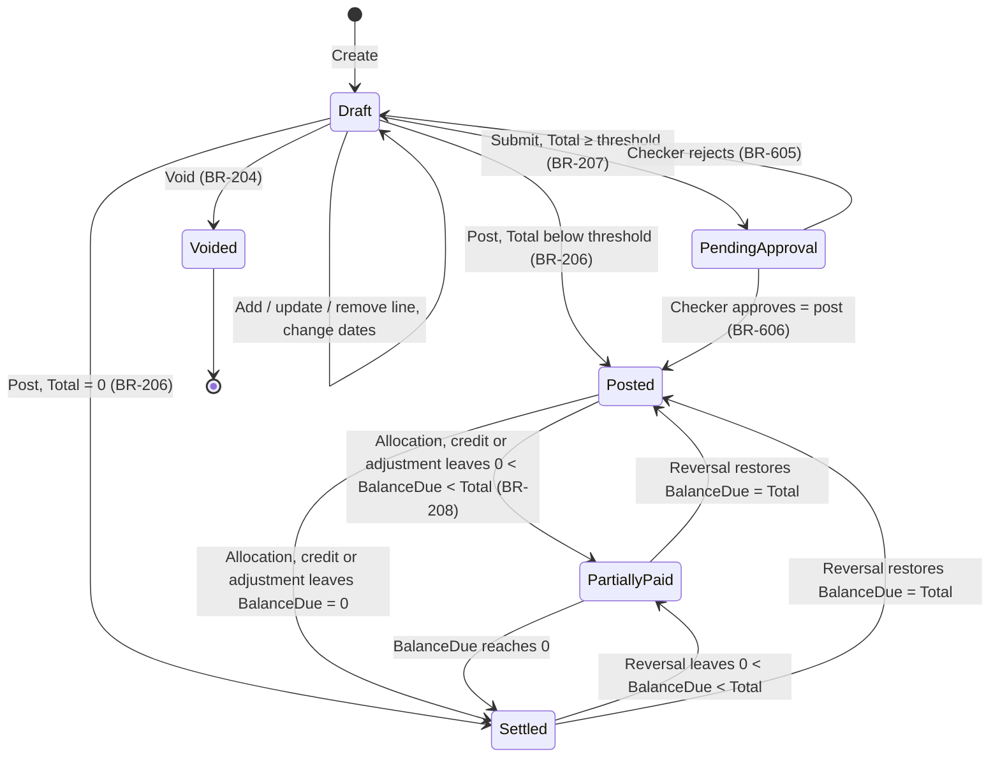

# Domain Model

- **Status:** R1 written 2026-09-29. Source of truth for rules is `requirements.md` (BR-nnn); this
  document says how those rules are expressed as aggregates, value objects, invariants and events.
  Storage is in `database.md`. Decisions are in `docs/adr/` (ADRs 0003–0010).
- **Domain:** hospital and clinic patient billing in India. R1 payers are self-pay only.

---

## 1. Ubiquitous language

| Term | Meaning |
|---|---|
| **Tenant** | One hospital or clinic; the unit of isolation. Every record below belongs to one tenant. |
| **Patient** | The person who received care. Identified within the tenant by MRN. |
| **Payer** | The party that owes money. In R1 always `SelfPay`: the patient themselves or a guarantor. |
| **Bill** | The document that charges a payer for services rendered to a patient. Has lines. Replaces the generic word "invoice". |
| **Payment** | Money received from a payer. Posted when recorded. Replaces "receipt". |
| **Allocation** | Applying part of a payment (or of a credit note's available credit) to a bill. |
| **Unapplied cash** | The part of a payment not yet allocated to any bill. |
| **Credit note** | A document that reduces what a payer owes on a bill; excess becomes **available credit**. |
| **Adjustment** | A document that reduces a bill's balance without money moving: discount, write-off, rounding. |
| **Refund** | Money returned to a payer from unapplied cash or available credit. |
| **Posting** | The act that makes a document financially effective: number, ledger entries, cache updates, audit, in one transaction. |
| **Ledger** | The receivables subledger: double-entry lines that are the source of truth for every balance. |
| **Cached balance** | A denormalised figure (`Bill.BalanceDue`, `Payment.UnappliedAmount`, `CreditNote.AvailableAmount`, `PayerBalance`) that must always equal a ledger sum (BR-404). |
| **Maker / Checker** | The user who requests a sensitive action and the different user who approves it (BR-603). |
| **Business date** | A calendar date in IST on a document (bill date, payment date). Distinct from the UTC instant when it was recorded (BR-003). |
| **Fiscal year** | 1 April – 31 March, labelled `2026-27` (BR-004). |

---

## 2. Module map

| Module | Aggregates / entities | Value objects and services | Notes |
|---|---|---|---|
| **Common** | `ApprovalRequest`, `NumberSeries` | `Money`, `UnitPrice`, `Quantity`, `Percent`, `FiscalYear`, `DocumentNumber`, typed ids (the `ITypedId` contract, and the ids other modules refer to: `TenantId` and `UserId`, which every module needs, and `PatientId` and `PayerId`, which bills, payments and the ledger name; modules share ids, never aggregates), `CommonErrors` (`validation_failed`, `concurrency_conflict`, `duplicate_key`), the base types `Entity<TId>`, `AggregateRoot<TId>`, `ITenantScoped`, `ICreationAudited`, `IModificationAudited`, `IHasRowVersion` (ADR 0015), `IClock`, `IUnitOfWork`, `ITenantContext`, `ICurrentUser`, `INumberSeries`, `IIdempotencyStore`, `Result<T>`, `Error` | Cross-cutting; usable by every module. |
| **Identity** | `Tenant`, `User` (with roles) | `Role` | JWT issuance and validation live in Infrastructure/Api. |
| **Payers** | `Patient`, `Payer` | `Mrn`, `PayerKind` | Reference data with lifecycle by status (BR-102, BR-105). |
| **Billing** | `Bill` + `BillLine`, `CreditNote` + `CreditNoteLine` + `CreditNoteAllocation`, `ServiceItem` | `BillNumber`, `CreditNoteNumber` | Publishes `IBillReadService` (bill balances) for Payments and Adjustments. |
| **Payments** | `Payment` + `PaymentAllocation`, `Refund` | `PaymentNumber`, `RefundNumber`, `PaymentMethod` | |
| **Receivables** | `LedgerPosting` + `LedgerEntry` (append-only), `PayerBalance` (cache) | `LedgerAccount`, `IReceivablesLedger` | Owns the posting templates and the reconciliation query. |
| **Adjustments** | `Adjustment` | `AdjustmentNumber`, `AdjustmentKind` | |
| **Reporting** | none (read models / queries) | `ReportBillStatus`, `ReportPaymentStatus`, `ReportPaymentMethod` (its own words for the Billing and Payments enums) | Reads any module's tables through query services; never writes. Built with Prompt 6.1 (ADR 0036): its Infrastructure may name the entities of every business module (five exceptions of ADR 0003), and `ReportingConventionTests` keeps it from writing. The dashboard (Prompt 6.3, ADR 0037) reads the ledger by business date through the Receivables contract `ILedgerMovements`. |
| **Audit** | `AuditRecord` (append-only) | `IAuditWriter` | Subscribes to every domain event. |

Cross-module rule (CLAUDE.md §3): a module touches another module's data only through that module's
Application contracts. Payments never loads `Bill` through a `DbSet`; it calls Billing's
`IBillRepository`/`IBillReadService`. The Receivables ledger is written only through
`IReceivablesLedger`.

---

## 3. Value objects

All value objects are immutable `record` or `readonly record struct` types in `BillingRecon.Domain.Common`
unless stated. Construction validates; an invalid value cannot exist.

| Type | Definition | Rules |
|---|---|---|
| `Money` | `readonly record struct` over a `decimal` `Amount`; INR only; exact to the paisa. | `Money.Of(decimal)` refuses a digit below the paisa (a bug; trailing zeros are fine), `Money.TryOf` says so without throwing. `Money.Round(decimal raw)` rounds `AwayFromZero` to 2 places and is the **only** way to turn a computed value into money (BR-001). `+`, `-`, unary `-`, comparisons, `Sum`, `Zero`, `IsZero`, `IsNegative`, `IsPositive`, `ToString` (`1234.50`). There is no `*` or `/` operator: multiply the raw decimals, then `Money.Round`. Stored as `decimal(18,2)` by convention (ADR 0004, built 2026-10-17). |
| `UnitPrice` | `decimal` exact to 4 decimals, `≥ 0`. | BR-201. `Of` (throws) and `TryOf` (for validators). Stored as `decimal(19,4)` by convention. |
| `Quantity` | `decimal` exact to 3 decimals, `> 0`. | BR-201. `Of` and `TryOf`; the struct's default (zero) is not a valid quantity. Stored as `decimal(9,3)` by convention. |
| `Percent` | `decimal` exact to 2 decimals, `0 ≤ value ≤ 100`. | Tax rates (BR-201). `Of` and `TryOf`. Stored as `decimal(5,2)` by convention. |
| `FiscalYear` | `(int StartYear)`; `Label` = `"2026-27"`; `Start` = 1 Apr, `End` = 31 Mar. | `FiscalYear.FromDate(DateOnly)`: month ≥ 4 → same year, else previous year (BR-004). |
| `DocumentNumber` | `(DocumentType Type, FiscalYear Year, string Prefix, int Sequence)`; `ToString()` = `PREFIX/YY-YY/NNNNNN`, for example `BIL/26-27/000123` (≤ 16 characters, ADR 0008). | Only `INumberSeries` creates one, inside a posting transaction (BR-801). `BillNumber`, `CreditNoteNumber`, `PaymentNumber`, `AdjustmentNumber`, `RefundNumber` are thin typed wrappers so a bill number cannot be assigned to a payment. |
| Typed ids | `TenantId`, `UserId`, `PatientId`, `PayerId`, `ServiceItemId`, `BillId`, `BillLineId`, `CreditNoteId`, `PaymentId`, `AllocationId`, `AdjustmentId`, `RefundId`, `ApprovalRequestId`, `PostingId`, `CorrelationId` — each `readonly record struct X(Guid Value) : ITypedId`. | Prevents passing a `PaymentId` where a `BillId` is expected. The `Guid` is generated client-side (sequential) by EF when the entity is added to the context: the id is empty before that and known before anything is saved (ADR 0015). |
| `Mrn` | `readonly record struct` (Payers) over the text as entered: trimmed, 1 to 30 characters, no control characters. | BR-101. `Of` and `TryOf`. Equality ignores the case of letters, as the unique index does under the database's case-insensitive collation. A struct so that Entity Framework stores it as a column (ADR 0015, built note of 2026-10-17); its default value is empty and is not an MRN, and `Patient.Register` refuses it. Stored as `nvarchar(30)` through a converter in the entity configuration. |
| `PaymentMethod` | enum `Cash, Card, Upi, BankTransfer, Cheque`. | BR-301. |
| `PayerKind` | enum `SelfPay` (R1), `Insurer`, `Corporate` (reserved). | BR-103: only `SelfPay` is accepted in R1. |
| `AdjustmentKind` | enum `Discount, WriteOff, Rounding`. | BR-501. |
| `LedgerAccount` | enum `Receivable, UnappliedCash, CreditAvailable, Revenue, Cash, Adjustments`. | BR-403. |
| `DateOnly` | Used directly for business dates. | Always IST calendar dates (BR-003). |

Line arithmetic lives in one place, `LineCalculator` (Domain, Billing), used by `BillLine` and
`CreditNoteLine`:

```
LineAmount    = Money.Round(Quantity × UnitPrice)
TaxableAmount = LineAmount − DiscountAmount
TaxAmount     = Money.Round(TaxableAmount × TaxRate / 100)
LineTotal     = TaxableAmount + TaxAmount
```

Example (BR-202): 3 × ₹333.3333 → `LineAmount` 1000.00 (999.9999 rounds up), discount ₹0.50 →
taxable 999.50, GST 5% → tax `Money.Round(49.975)` = **49.98** (away from zero, not banker's 49.98/49.97
ambiguity), `LineTotal` 1049.48. Totals are sums of these, never rounded again (BR-203).

---

## 4. Aggregates

Conventions for every aggregate root: `TenantId` (BR-002, `ITenantScoped`), typed `Id`
(`AggregateRoot<TId>`), `RowVersion` concurrency token (BR-804, `IHasRowVersion`), and the audit
columns `CreatedAtUtc` / `CreatedByUserId` and `UpdatedAtUtc` / `UpdatedByUserId`
(`ICreationAudited`, `IModificationAudited`). The tenant, the id and the audit columns are filled by
the persistence layer from `ITenantContext`, `ICurrentUser` and `IClock`; an aggregate never assigns
them (ADR 0015). `Tenant` itself is the exception: it is not tenant-scoped (a tenant sees and writes its own row
only, ADR 0015) and has `CreatedAtUtc`
only. Roots expose behaviour methods that return `Result` for business failures; they never throw
for expected cases. Roots raise domain events (§8) that the unit of work dispatches before commit;
an event must not copy the aggregate's id inside a factory method, where the id is still empty.

### 4.1 Patient (Payers module)

| | |
|---|---|
| **Root** | `Patient` |
| **Fields** | `Mrn`, `FullName`, `DateOfBirth?`, `Sex?`, contact and address fields, `Status` (`Active`, `Inactive`) |
| **Commands** | `Register(mrn, details)`, `UpdateDemographics(details)` (replaces every field but the MRN and the status; a value left out is cleared), `Deactivate`, `Reactivate` (each refuses the status the patient already has: `patient_already_inactive`, `patient_already_active`) |
| **Invariants** | MRN unique per tenant (BR-101, enforced by unique index and checked in the use case). Never deleted (BR-102). `Inactive` patients cannot be billed (checked by `Bill.Create`). Text without surrounding white space, blank optional values null, every value within its column (a value the validator would refuse is a bug and throws). |
| **Events** | `PatientRegistered`, `PatientDeactivated`, `PatientReactivated` |
| **Built** | 2026-10-17 (Prompt 2.2, ADR 0018): `Domain/Payers`, the use cases in `Application/Payers`, the table `Patients` (`database.md` §3.2), the endpoints in `docs/api.md` §8.1. The demographics travel as one `PatientDetails` record. |

### 4.2 Payer (Payers module)

| | |
|---|---|
| **Root** | `Payer` |
| **Fields** | `Kind` (`SelfPay`), `Name`, `PatientId?` (the patient this self-pay payer *is*), contact fields, `Status` |
| **Commands** | `Create(kind, details, patientId?)`, which refuses `Insurer` and `Corporate` with `payer_kind_not_supported` (BR-103); `Update(details)` (the name and contact details; a contact detail left out is cleared); `Deactivate`, `Reactivate` |
| **Invariants** | `Kind == SelfPay` in R1 (BR-103). At most one payer per `PatientId` (BR-104, filtered unique index, checked in the use case), and only for an active patient of the tenant (checked in the use case). The kind and the patient link never change. Never deleted; inactive payers receive no new bills, payments or refunds (BR-105, BR-309). |
| **Events** | `PayerCreated`, `PayerDeactivated`, `PayerReactivated` |
| **Built** | 2026-10-17 (Prompt 2.2, ADR 0018): `Domain/Payers`, the use cases in `Application/Payers`, the table `Payers` (`database.md` §3.2), the endpoints in `docs/api.md` §8.2. The zero `PayerBalance` row is created with the Receivables slice, which also creates it for every payer that exists by then. |

`PayerBalance` is **not** part of this aggregate. It is a Receivables cache keyed by `PayerId` (§4.10).

### 4.3 ServiceItem (Billing module, reference data)

Chargemaster entry: `Code` (unique per tenant), `Name`, `Category?`, `DefaultUnitPrice`,
`TaxRate`, `Status` (`Active`, `Inactive`). A bill line may copy price and tax rate from it; the line keeps its own
copy so later price changes never alter a bill. Deactivated, never deleted.

Built with Prompt 2.3 (2026-11-20), shaped like `Payer` (ADR 0018):

- `Code` is the value object `ServiceItemCode` (Billing): kept as entered, trimmed, 1 to 30 ASCII characters, each
  a letter, a digit or one of `. - _ /`; equality ignores the case of letters, as the unique index does. It is
  **fixed at creation**: price lists and people refer to it, so it must not come to mean another service.
- `DefaultUnitPrice` is a `UnitPrice` and `TaxRate` a `Percent` (§3, BR-201). Zero is valid for both; neither has
  a default, the use case requires them.
- `Status` replaces the `IsActive` flag of the first design, so that reference data has one shape: `Deactivate`
  and `Reactivate` return `service_item_already_inactive` and `service_item_already_active` when there is nothing
  to change.
- Events: `ServiceItemCreated`, `ServiceItemDeactivated`, `ServiceItemReactivated`. A correction raises none yet;
  the audit slice decides what a correction records.
- `ServiceItemId` lives in Common, because bill lines and credit note lines will name the item they were priced
  from.

### 4.4 Bill + BillLine (Billing module)

| | |
|---|---|
| **Root** | `Bill` |
| **Children** | `BillLine` (`LineNo`, `ServiceItemId?`, `Description`, `Quantity`, `UnitPrice`, `DiscountAmount`, `TaxRate`, computed `LineAmount`, `TaxAmount`, `LineTotal`). `Quantity`, `UnitPrice` and `TaxRate` are the value objects of §3, which the use case makes with `TryOf` (BR-201 as a business failure); a line is never built from a struct default, which for `Quantity` is the invalid zero. |
| **Fields** | `Number?` (null until posted), `FiscalYear?`, `PatientId`, `PayerId`, `BillDate`, `DueDate`, `EncounterReference?`, `Notes?`, `Status`, `SubTotal`, `DiscountTotal`, `TaxTotal`, `Total`, `BalanceDue`, posted/voided stamps |
| **Commands** | `Create`, `AddLine`, `UpdateLine`, `RemoveLine` (draft only), `ChangeDates`, `Void`, `SubmitForApproval`, `Post(number, clock, user)`, `ApplyCredit(amount)` / `RestoreBalance(amount)` (called only by posting use cases, see §6) |
| **Invariants** | Lines per BR-201; arithmetic per BR-202; totals per BR-203; at least one line to post. Draft-only editing and voiding (BR-204). Dates per BR-205. `Number` present iff posted (BR-206). Frozen after posting (BR-006, BR-209): every mutating method returns `Error(bill_already_posted)` once `Status ∉ {Draft, PendingApproval}`. `0 ≤ BalanceDue ≤ Total` (BR-405). Status follows balance (BR-208). Threshold approval (BR-207). Patient and payer active at creation (BR-102, BR-105). |
| **Events** | `BillPosted`, `BillVoided`, `BillSubmittedForApproval`, `BillBalanceChanged` |

State machine: §5.

**Built with Prompt 2.4 (2026-11-20, ADR 0019): the draft.** What exists so far, and where it differs from the table
above:

- **States:** `Draft`, `Voided`, and since Prompt 3.5 `Posted` and `Settled` (a bill that comes to nothing is settled
  the moment it is posted); `PartiallyPaid` exists and nothing reaches it yet; since Prompt 3.6 `PendingApproval`, for a bill at or above the
  threshold of the tenant: `SubmitForApproval`, then `PostApproved` (the checker's approval) or `ReturnToDraft` (the
  rejection); a bill that waits answers `bill_pending_approval` (409) to every other command (ADR 0023).
  Every mutating method refuses unless the bill is a draft: a voided draft with `bill_not_draft` (422), a posted bill
  with `bill_already_posted` (409). `Post(number, postedAtUtc, postedBy, window)` sets the number, the fiscal year,
  the sequence number and the posted stamps and raises `BillPosted`; `CheckCanPost(window)` lets the use case ask
  before it takes the number (ADR 0022).
- **Commands:** `Create`, `ReplaceLines` (in place of `AddLine`, `UpdateLine` and `RemoveLine`: one request replaces
  every line, a line that keeps its position keeps its row, the rest are added or removed), `UpdateHeader` (in place
  of `ChangeDates`: both dates, the encounter reference and the notes), `Void(reason, instant, user)`.
- **Fields:** everything above except `Number` and `FiscalYear` and the posted stamps. The patient and the payer
  are fixed at creation. `BalanceDue` equals `Total` on a draft.
- **Lines:** `BillLine.Check` applies BR-201 to one line and returns its `LineAmounts`; the bill checks every line
  before it keeps any. Two failures are business rules (422): `bill_line_discount_exceeds_amount` and
  `bill_line_amount_too_large` (a line amount above 9,999,999,999.99). At most 200 lines.
- **Dates:** the use case hands in a `BusinessDateWindow` built from `IClock.TodayIst` and the tenant's
  `MaxBackdateDays`; the aggregate answers `bill_date_in_future`, `bill_date_too_old` or
  `bill_due_date_before_bill_date` (BR-205). A bill date is checked when it is entered or changed, not on every
  edit, and will be checked again at posting.
- **Events:** `BillDrafted` and `BillVoided`. Edits of a draft raise none yet; the audit slice decides what they
  record.
- **Patient and payer:** checked by the use case through `IBillableParties`, a contract of the Payers module
  (Application): both must exist for the tenant and be active (BR-102, BR-105). No link between them is required
  (BR-106).
- **Service items:** a line that names one takes from it the description, the unit price and the tax rate the
  request leaves out, read through `IServiceItemReadService`, and keeps its own copy. An inactive item is refused
  (`service_item_inactive`) unless the draft already has a line for it.
- **Tenant settings:** read through `ITenantSettingsReader` (Application, Identity): `MaxBackdateDays` and
  `DefaultDueDays`.

### 4.5 CreditNote + CreditNoteLine + CreditNoteAllocation (Billing module)

| | |
|---|---|
| **Root** | `CreditNote` |
| **Children** | `CreditNoteLine` (as `BillLine`, plus `BillLineId?`); `CreditNoteAllocation` (`BillId`, `Amount`, `Status`, posting refs) |
| **Fields** | `Number?`, `FiscalYear?`, `BillId`, `PayerId`, `PatientId`, `CreditNoteDate`, `Reason`, `Status` (`Draft`, `PendingApproval`, `Posted`, `Voided`), totals, `AvailableAmount` |
| **Commands** | `Create(bill)`, line edits (draft only), `SubmitForApproval`, `Post` (checker), `Void`, `Apply(bill, amount)`, `ReverseApplication(allocation)` |
| **Invariants** | Against one posted bill of the same payer; `Σ posted credit note totals ≤ Bill.Total` (BR-210, checked at posting through `IBillReadService`). Referenced line cap (BR-211). Maker-checker (BR-212, BR-604). At posting: `AvailableAmount = Total`, then auto-apply `min(Total, Bill.BalanceDue)` to its bill. `0 ≤ AvailableAmount ≤ Total` (BR-213, BR-405). `CreditNoteDate ≥ Bill.BillDate` (BR-214). Frozen after posting (BR-006). |
| **Events** | `CreditNotePosted`, `CreditApplied`, `CreditApplicationReversed`, `CreditNoteVoided` |

*Built 2026-11-21 (Prompt 4.3, ADR 0025).* `CreditNote.Create(billId, payerId, patientId, billDate, creditNoteDate,
reason, lines, window)` makes the draft; the aggregate takes the id and the date of its bill, never the bill.
`ReplaceLines`, `UpdateHeader` and `Void` change a draft. `SubmitForApproval` (a line, a total above zero, a date
still allowed) makes it `PendingApproval`; `PostApproved(number, ...)` posts it with `AvailableAmount = Total`;
`ReturnToDraft(reason)` is the rejection. `CheckWithinBill(billTotal, alreadyCredited, billLineTotals,
alreadyCreditedByLine)` is the rule of BR-210 and BR-211, which the use case feeds with the posted credit notes of
the bill, before any lock and again under the ledger's lock. `Apply(billId, amount, ...)` lowers `AvailableAmount`
and keeps a `CreditNoteAllocation` (status `Active`, the only one so far); the automatic application to its own bill
is made by the approval use case, `min(Total, Bill.BalanceDue)`, not by the aggregate, because it needs the bill.
The events as built: `CreditNoteDrafted`, `CreditNoteHeaderUpdated`, `CreditNoteLinesReplaced`, `CreditNoteVoided`,
`CreditNoteSubmittedForApproval`, `CreditNoteReturnedToDraft`, `CreditNotePosted` and `CreditNoteApplied` (each
named after its aggregate, as the audit trail needs: ADR 0020); the bill raises `BillCreditApplied`. A
`CreditNoteLine` has no service item; it may name a `BillLineId`.

*Reversing an application, built 2026-11-21 (Prompt 4.5b, ADR 0028).* The approval use case now applies the credit
to its own bill with `ApplyToOwnBillAtPosting(amount, ...)`, which marks that application `AppliedAtPosting` and is
allowed once, as the first application of a credit note just posted; `Apply` makes every later one. A later
application is reversed in three steps: `RequestApplicationReversal(applicationId, reason)` makes it
`PendingReversal` (refused for the application made at posting, for one that waits and for one that is reversed);
`ReverseApplication(applicationId, reason, at, checker)` marks it `Reversed` with who, when and why and raises
`AvailableAmount` by its amount; `RejectApplicationReversal(applicationId, reason)` makes it `Active` again.
`AttachApplicationReversalPosting` records the mirror posting once. While it waits, an application still counts as
applied (`IsApplied`), and the credit note can still apply more of its credit. The bill is given the amount back by
the use case through `IBillSettlement.RestoreAsync` (`Bill.ReverseCredit`, which raises `BillCreditReversed`). The
events: `CreditNoteApplicationReversalRequested`, `CreditNoteApplicationReversalRejected` and
`CreditNoteApplicationReversed`, each with the number of the credit note and the reason; the
`CreditApplicationReversed` of the table above is built under that last name.

### 4.6 Payment + PaymentAllocation (Payments module)

| | |
|---|---|
| **Root** | `Payment` |
| **Children** | `PaymentAllocation` (`BillId`, `Amount`, `Status` (`Active`, `PendingReversal`, `Reversed`), allocated/reversed stamps, `PostingId`, `ReversalPostingId?`) |
| **Fields** | `Number`, `FiscalYear`, `PayerId`, `PaymentDate`, `Method`, `Reference?`, `Amount`, `UnappliedAmount`, `Status` (`Posted`, `PendingReversal`, `Reversed`), reversal stamps |
| **Commands** | `Record(...)` (creates *and* posts, BR-302), `Allocate(bill, amount)`, `RequestAllocationReversal`, `ReverseAllocation` (checker), `RequestReversal`, `Reverse` (checker) |
| **Invariants** | `Amount > 0`; reference required unless Cash; date per BR-205 (BR-301). Payer active (BR-309). Allocation caps: `0 < amount ≤ UnappliedAmount` and `≤ Bill.BalanceDue`, same payer (BR-303). `0 ≤ UnappliedAmount ≤ Amount` (BR-405). Reversal only if no refund was posted from it (BR-306); reversal reverses active allocations first. `Reversed ⇒ UnappliedAmount = 0`. Financial fields frozen from creation (BR-006). |
| **Events** | `PaymentRecorded`, `PaymentAllocated`, `AllocationReversed`, `PaymentReversed` |

*Built 2026-11-20 (Prompt 4.1): recording.* `Payment.Record(payer, paymentDate, method, reference, amount, notes,
number, window)` creates the payment posted, under the number it is given, with `UnappliedAmount = Amount`, and
raises `PaymentRecorded` (number, payer, method, amount, date), which the audit trail writes as `Recorded`.
`Payment.CheckDate` is the BR-205 check, so the use case can refuse a date before it takes a number; a date the
window refuses is the one failure `Record` returns, and everything else it is handed wrong is a bug and throws
(the validator refuses it first). `AttachPosting(postingId)` is called once, by the use case, with the id the
ledger answered. The status has `Posted` alone so far. `BusinessDateWindow` is in `Domain/Common` since this
prompt, shared with bills.

*Built 2026-11-20 (Prompt 4.2, ADR 0024): allocation.* `Payment.CheckCanAllocate(amount)` answers
`allocation_exceeds_unapplied` for the sum of a request before anything changes. `Payment.Allocate(billId, amount,
allocatedAtUtc, allocatedBy)` lowers `UnappliedAmount`, keeps a `PaymentAllocation` (status `Active`, the only one
so far) and raises `PaymentAllocated` (the payment's number, the bill, the amount, what is left unapplied);
`AttachAllocationPosting` gives the allocation the id of its ledger posting, once. An allocation has no row version
of its own. On the other side `Bill.ApplyCredit(amount)` is the one change a posted bill accepts: it answers
`bill_not_posted` or `allocation_exceeds_balance_due`, or lowers `BalanceDue`, sets `PartiallyPaid` or `Settled`
(BR-208) and raises `BillCreditApplied`.

*Built 2026-11-21 (Prompt 4.5, ADR 0027): reversals.* `RequestAllocationReversal(allocationId, reason)` makes an
allocation `PendingReversal`; `ReverseAllocation(allocationId, reason, at, checker)` marks it `Reversed` and gives
its amount back to `UnappliedAmount`; `RejectAllocationReversal` makes it `Active` again. `RequestReversal(reason)`
makes the payment `PendingReversal`, which stops allocations; `Reverse(reason, at, checker)` takes back every
allocation still applied, answers them in the order of their bills, and leaves the payment `Reversed` with nothing
unapplied; `RejectReversal` makes it `Posted` again. One decision at a time: neither can be asked for while the
other waits. `AttachAllocationReversalPosting` and `AttachReversalPosting` keep the mirror postings. `Reverse`
throws if part of the payment went anywhere but to allocations; since Prompt 4.6 the use case asks first whether a
refund was posted from it (BR-306, ADR 0029), so a refunded payment never gets that far.
On the other side `Bill.ReverseCredit(amount)` is the mirror of `ApplyCredit` and raises `BillCreditReversed`.
The events as built, each named after its aggregate: `PaymentAllocationReversalRequested`,
`PaymentAllocationReversalRejected`, `PaymentAllocationReversed`, `PaymentReversalRequested`,
`PaymentReversalRejected`, `PaymentReversed`.

### 4.7 Refund (Payments module)

| | |
|---|---|
| **Root** | `Refund` |
| **Fields** | `Number?`, `FiscalYear?`, `PayerId`, `SourceKind` (`Payment` or `CreditNote`), `SourcePaymentId?` / `SourceCreditNoteId?` (exactly one), `RefundDate`, `Amount`, `Method`, `Reference?`, `Reason`, `Status` (`Draft`, `PendingApproval`, `Posted`, `Voided`) |
| **Commands** | `Draft`, `SubmitForApproval`, `Post` (checker), `Void` |
| **Invariants** | `Amount > 0` and `≤ source available amount at posting` (BR-307). Exactly one source. Maker-checker (BR-604). Not reversible (BR-308). Payer active (BR-309). |
| **Events** | `RefundPosted`, `RefundVoided` |

*Built 2026-11-21 (Prompt 4.6, ADR 0029).* `Refund.Create(source, payerId, sourceDate, refundDate, amount, method,
reference, reason, window)` makes the draft; `RefundSource.FromPayment` or `FromCreditNote` names its one source,
and the aggregate takes the payer and the date of that source, never the source itself. The date lies in the window
of BR-205 and not before the source's date (BR-307). The method and the reference follow the rules of a payment
(BR-301). `Update` replaces a draft as a whole (the source stays), `Void` gives it up, `SubmitForApproval` hands it
over, `CheckFits(sourceNumber, available)` is the cap, asked when the maker submits and again at the approval,
`PostApproved(number, ...)` posts it under a refund number of the fiscal year of its date, `ReturnToDraft(reason)` is
the rejection, and `AttachPosting` keeps the ledger posting. Nothing reverses a posted refund. The sources pay:
`Payment.PayRefund(refundNumber, amount)` lowers `UnappliedAmount` while the payment is posted (`CheckCanRefund`
refuses one that waits for its reversal or was reversed) and raises `PaymentRefunded`; `CreditNote.PayRefund`
lowers `AvailableAmount` of a posted credit note and raises `CreditNoteRefunded`; the use case reaches the credit
note through `ICreditNoteSettlement`. The events of the refund as built: `RefundDrafted`, `RefundUpdated`,
`RefundVoided`, `RefundSubmittedForApproval`, `RefundReturnedToDraft`, `RefundPosted`.

### 4.8 Adjustment (Adjustments module)

| | |
|---|---|
| **Root** | `Adjustment` |
| **Fields** | `Number?`, `FiscalYear?`, `BillId`, `PayerId`, `AdjustmentDate`, `Kind`, `Amount`, `Reason`, `Status` (`Draft`, `PendingApproval`, `Posted`, `Voided`) |
| **Commands** | `Draft`, `SubmitForApproval`, `Post` (checker), `Void` |
| **Invariants** | One posted bill; `0 < Amount ≤ Bill.BalanceDue` at posting; `Rounding < 1.00` (BR-501). Reason required; maker-checker (BR-502). Reduces only (BR-503). |
| **Events** | `AdjustmentPosted`, `AdjustmentVoided` |

*Built 2026-11-21 (Prompt 4.4, ADR 0026).* `Adjustment.Create(billId, payerId, billDate, adjustmentDate, kind,
amount, reason, window)` makes the draft; the aggregate takes the id and the date of its bill and what the bill is
owed, never the bill. `Update` and `Void` change a draft. `CheckFits(billNumber, balanceDue)` is the cap of BR-501,
which the use case asks when the maker submits and again when the checker approves. `SubmitForApproval` makes it
`PendingApproval` (every adjustment, a rounding included); `PostApproved(number, ...)` posts it;
`AttachPosting` keeps the id of its ledger posting; `ReturnToDraft(reason)` is the rejection. The module reaches
the bill only through `IBillSettlement` of Billing (`FindPostedAsync` to read it, `ApplyAsync` to lower it); the
exception `Application.Adjustments` to `Domain.Billing` that ADR 0003 lists was not needed and is not used. The
events as built: `AdjustmentDrafted`, `AdjustmentUpdated`, `AdjustmentVoided`, `AdjustmentSubmittedForApproval`,
`AdjustmentReturnedToDraft` and `AdjustmentPosted`; the bill raises `BillCreditApplied`. There is no reversal of a
posted adjustment: a wrong one is corrected by a new bill (BR-503).

### 4.9 ApprovalRequest (Common module)

| | |
|---|---|
| **Root** | `ApprovalRequest` |
| **Fields** | `DocumentType`, `DocumentId`, `Action` (`Post`, `Reverse`, `ChangePrefix`), `MakerUserId`, `MakerComment?`, `CheckerUserId?`, `CheckerComment?`, `Status` (`Pending`, `Approved`, `Rejected`), `RequestedAtUtc`, `DecidedAtUtc?`, `CorrelationId` |
| **Commands** | `Open(maker)`, `Approve(checker)`, `Reject(checker, comment)` |
| **Invariants** | `CheckerUserId ≠ MakerUserId` (BR-603; also a CHECK constraint). Checker holds Supervisor or TenantAdmin (checked by the use case from `ICurrentUser`). One pending request per document (BR-605; filtered unique index). Decision is final. |
| **Events** | `ApprovalRequestOpened`, `ApprovalRequestApproved`, `ApprovalRequestRejected` (first planned as `ApprovalRequested`, `ApprovalGranted`, `ApprovalRejected`; ADR 0023) |

The approval use case (`ApproveRequestHandler`) loads the request and the target document, calls the
document's `Post`/`Reverse`, and commits everything in one transaction (BR-606). The request itself
never carries financial data.

*Built 2026-11-20 (Prompt 3.6, ADR 0023).* The commands are `Open`, `Approve(checker, comment?, at)` and
`Reject(checker, comment, at)`; a decision by the maker fails with `approval_checker_is_maker` (403), so does, since 2026-11-26 (review finding
R9), an approval by one of the `writers` the use case hands to `Approve` (who created the document, who changed it
last), and a second
decision with `approval_already_decided` (409). The events are named `ApprovalRequestOpened`,
`ApprovalRequestApproved` and `ApprovalRequestRejected`, so that the audit trail derives `Opened`, `Approved` and
`Rejected` from them (ADR 0020). There is no generic `ApproveRequestHandler`: the first use is the bill, with
`ApproveBillPostingHandler` and `RejectBillPostingHandler` in Billing, and each later document brings its own.
*Built 2026-11-21 (Prompt 5.3, ADR 0032):* the decision itself checks that the checker holds Supervisor or
TenantAdmin. `Approve(checker, checkerRoles, comment?, at)` and `Reject(checker, checkerRoles, comment, at)` take the
roles of `ICurrentUser`, and a checker without either role fails with `approval_checker_role` (403), after the check
of the maker; the API's `Decide` policy refuses such a user before.

### 4.10 LedgerPosting + LedgerEntry, PayerBalance (Receivables module)

| | |
|---|---|
| **Root** | `LedgerPosting` (append-only) |
| **Children** | `LedgerEntry` (`LineNo`, `Account`, `SubjectType?`, `SubjectId?`, `PayerId?`, `Debit`, `Credit`) |
| **Fields** | `PostedAtUtc`, `BusinessDate`, `Kind`, `DocumentType`, `DocumentId`, `PayerId`, `ReversalOfPostingId?`, `Description`, `PostedByUserId`, `CorrelationId` |
| **Creation** | Only through `IReceivablesLedger.PostAsync(PostingTemplate, ct)`, which builds the lines from the templates in `database.md` §5.3, asserts `Σ Debit = Σ Credit` (BR-401), writes the entries and applies the cache deltas to `PayerBalance` in the same transaction (BR-404). |
| **Invariants** | Balanced; two or more lines; each line has exactly one of Debit/Credit > 0; subject rules per BR-403; never updated or deleted (BR-402). |

`PayerBalance` (`PayerId`, `Receivable`, `UnappliedCash`, `CreditAvailable`, computed
`NetOutstanding`) is a cache row updated by atomic set-based increments inside the posting
transaction. It has no rowversion and is never edited by hand; drift is detected by the
reconciliation query (BR-404).

*Built 2026-11-20 (Prompt 3.3; ADR 0005 built note, ADR 0021).* As above. `LedgerPosting` and `LedgerEntry` carry
`IAppendOnly`. The port takes a `PostingTemplate` of the Application layer, and each financial event gets a named
factory on it with the slice that builds its document. A posting that would take a subject balance below zero is
refused with `ledger_balance_negative` before anything is written. The balances of the payer are read under an
update lock and changed in the transaction of the request. `PayerBalance` is opened at zero by the use case that
creates the payer, through `IPayerAccounts`; it has no `LastPostingId`.

### 4.11 NumberSeries (Common module)

`(TenantId, DocumentType, FiscalYear)` → `Prefix`, `NextNumber`. `INumberSeries.NextAsync(type,
fiscalYear, ct)` runs inside the caller's transaction, locks the row (`UPDLOCK, HOLDLOCK`), creates it
on first use with the tenant's default prefix, increments it and returns a `DocumentNumber` (BR-801,
BR-802). Prefix changes go through `ApprovalRequest` with `Action = ChangePrefix`.

**Built with Prompt 3.1 (2026-11-20; ADR 0008, "Built 2026-11-20").** `FiscalYear`, `DocumentType` and
`DocumentNumber` are in Domain, Common; the port is in Application, Common; the implementation is
`NumberSeriesAllocator` in Infrastructure, Common/Numbering. Where the build is more precise than the lines above:

- `FiscalYear` is a `readonly record struct` with `Of(startYear)`, `FromDate`, `Parse` and `TryParse` of a label,
  `Label` (`2026-27`), `ShortLabel` (`26-27`), `Start`, `End` and `Contains`. Its default value is not a fiscal year.
- `DocumentNumber` is built by `DocumentNumber.Create(type, fiscalYear, prefix, sequence)` and has `Value`. A
  number that would be longer than 16 characters cannot be built (CGST rule 46(b)), so a series whose next number
  no longer fits is exhausted: the allocator fails, and nothing is issued. The typed wrappers (`BillNumber` and the
  others) arrive with the documents that use them.
- "The caller's transaction": `NextAsync` opens a transaction on the request's context when none is open, and
  `IUnitOfWork.CommitAsync` commits it with the save or rolls it back. A use case that takes a number and does not
  commit gives the number back when its request ends.
- The tenant is the one of the current scope; it is not a parameter of `NextAsync`.
- `NumberSeries` is an entity of the model that nothing creates or advances through code: the allocator's one
  statement does both. *Since Prompt 5.3b (ADR 0033)* it is an aggregate with one command, `ChangePrefix(prefix, at)`,
  which an approved prefix change calls for the series of the current fiscal year; it raises `NumberSeriesPrefixChanged`
  and leaves `NextNumber` alone. *Since 2026-11-23 (ADR 0033, "Amended 2026-11-23")* the approval first holds the
  series through `INumberSeries.HoldAsync`, the allocator's locked read alone, whether the series exists yet or not:
  no number is taken from it and nobody creates it until the approval commits, so a series that does not exist yet
  cannot be created with the old prefix in the instant of an approval. The row version still guards the change.
- No document takes a number yet; bill posting is the first (Prompt 3.5).

### 4.12 Tenant and User (Identity module)

`Tenant`: `Code`, `Name`, `Status`, settings (`PostingApprovalThreshold?`, `MaxBackdateDays`,
`DefaultDueDays`, default prefixes per document type). Settings changes are audited (BR-607).
Built so far: `Tenant.Create(code, name, createdAtUtc)`, which returns a validation failure
(`tenant_invalid`, with messages per field) unless the code is 1–20 lower-case letters, digits and
single hyphens and the name is 1–200 characters, and which sets the initial settings (active, no
threshold, 7 days of back-dating, due on the bill date, prefixes `BIL`, `CN`, `PAY`, `ADJ`, `REF`).
The threshold is `Money`. Changing the settings was built with Prompt 5.3b (below); suspending a tenant is still to
come.
`User`: `Email` (unique per tenant), `DisplayName`, `PasswordHash`, `Status`, `Roles`. JWT issuance
is an Infrastructure concern; the Domain only knows roles (BR-601, BR-602).

*`User` built 2026-11-21 (Prompt 5.1, ADR 0030).* `User.Create(email, displayName, passwordHash, roles, createdAtUtc,
grantedBy)` makes an active user with the address trimmed and its upper-cased `NormalizedEmail`, and each role once
as a `UserRole` child (`Role`, `GrantedAtUtc`, `GrantedByUserId`). `Update(email, displayName)`, `ReplaceRoles(roles,
grantedAtUtc, grantedBy)` (a kept role keeps its grant, a new one is granted now, one left out is deleted), `Disable`,
`Enable` and `ResetPassword(passwordHash)` change it. The hash is opaque text to the aggregate; hashing and checking
are the Infrastructure's `IPasswordHasher`. That an address is free and that the user is not the tenant's last active
administrator are the use cases' questions, since they are about other users. `Role` is an enum of the five roles;
`RoleDefinition` is a row of the global `Roles` table. The events: `UserCreated`, `UserUpdated`, `UserRolesReplaced`,
`UserDisabled`, `UserEnabled` and `UserPasswordReset`, none of which carries a password or a hash. Suspending a
tenant is still to come.

*Tenant settings and `PrefixChange` built 2026-11-21 (Prompt 5.3b, ADR 0033).* `Tenant.ChangeSettings(threshold?,
maxBackdateDays, defaultDueDays)` sets the three settings and raises `TenantSettingsChanged`, or returns false when
nothing changes; `Tenant.ChangePrefix(type, prefix)` gives one type a new default and raises `TenantPrefixChanged`, and
refuses a prefix another type has as its default; `PrefixOf(type)` and `Prefixes` read them. `PrefixChange` (Identity)
is a TenantAdmin's request for a new prefix of one type: `Request(type, from, to)` (pending, `PrefixChangeRequested`),
then `RecordApproval(at)` (`PrefixChangeApproved`) or `RecordRejection(reason, at)` (`PrefixChangeRejected`), once.
The approval request (document type `PrefixChange`, action `ChangePrefix`) holds who decided; the use case asks whether
the prefix belongs to another type, on the request and again on the approval, and on the approval changes the tenant's
default and the series of the current fiscal year.

### 4.13 AuditRecord (Audit module)

Append-only: `OccurredAtUtc`, `UserId?`, `CorrelationId`, `EntityType`, `EntityId`, `DocumentNumber?`,
`Action`, `BeforeJson?`, `AfterJson?`, `Reason?`. Written by `IAuditWriter` from domain events and from
explicit calls in use cases, always inside the unit of work (BR-701, BR-702).

*Built 2026-11-20 (Prompt 3.4, ADR 0020).* `AuditRecord` is created complete by `AuditRecord.Create` and has no
behaviour; it carries `IAppendOnly`, and the persistence layer refuses to update or delete it. Its id is a number
the database assigns, not a typed id. So far every record comes from a domain event, through the generic
`AuditSubscriber`; no use case calls `IAuditWriter` itself yet.

---

## 5. State machines

### 5.1 Bill



- `Draft` and `PendingApproval` are the only states with editable content; `PendingApproval` is
  locked for editing but has no number and no ledger effect.
- `Posted`, `PartiallyPaid` and `Settled` are one family: the bill is financially frozen (BR-006) and
  the status is a pure function of `BalanceDue` versus `Total` (BR-208). There is no `Cancelled` state
  for a posted bill; a full credit note takes it to `Settled`.

### 5.2 Credit note, adjustment, refund (maker-checker documents)

```
Draft ──Submit──▶ PendingApproval ──Approve──▶ Posted
  │                     │
  │◀──────Reject────────┘
  └──Void──▶ Voided
```

`Posted` is terminal (BR-006). Reversals of these documents are out of scope in R1 (BR-308; a
posted credit note or adjustment is corrected by a new bill, a posted refund by a new payment). Only the later
applications of a posted credit note's credit can be reversed (ADR 0028), which leaves the credit note posted.

### 5.3 Payment and allocations

```
Payment:     Posted ──RequestReversal──▶ PendingReversal ──Approve──▶ Reversed
                ▲                              │
                └──────────Reject──────────────┘

Allocation:  Active ──RequestReversal──▶ PendingReversal ──Approve──▶ Reversed
                ▲                              │
                └──────────Reject──────────────┘
```

A payment in `PendingReversal` cannot be allocated or refunded; a `Reversed` payment has
`UnappliedAmount = 0` and all its allocations `Reversed` (BR-306).

An application of a credit note's credit (`CreditNoteAllocation`) has the allocation's three states and moves
between them the same way (ADR 0028), except that the application a credit note makes to its own bill when it is
posted stays `Active` for good. The credit note itself stays `Posted`: it is never reversed as a whole, and it can
apply more of its credit while one of its applications waits.

### 5.4 ApprovalRequest

`Pending → Approved | Rejected`, decided once, by a user other than the maker (BR-603).

---

## 6. Transaction boundaries and the allocation exception

**Default rule.** A use case commands **one document aggregate** and commits **one unit of work**
(BR-007). Ledger entries, the `PayerBalance` cache and audit records are written by services inside
that same unit of work; they are consequences of the command, not separate aggregates being
commanded.

**The exception: allocation commands two aggregates.** `AllocatePaymentHandler` loads both the
`Payment` and the `Bill`, validates BR-303 against both (`amount ≤ Payment.UnappliedAmount` and
`amount ≤ Bill.BalanceDue`), calls `payment.Allocate(bill.Id, amount)` and `bill.ApplyCredit(amount)` (the aggregates take ids, never
each other: ADR 0003, amendment of 2026-10-17),
posts the paired ledger entry `Dr UnappliedCash(payment) / Cr Receivable(bill)`, and saves both
under **both** rowversions. If either rowversion is stale the whole transaction fails with 409
`concurrency_conflict` (BR-804).

*Built 2026-11-20 (Prompt 4.2, ADR 0024), with two precisions.* The handler is in Payments and does not load the
bill itself: it asks `IBillSettlement.ApplyAsync(billId, payerId, amount)`, a contract of Billing, which loads the
bill, checks the payer and calls `bill.ApplyCredit`; the bill is tracked by the same unit of work and saved by the
handler's commit. And one request may name up to 50 bills: one `PaymentAllocation` and one ledger posting for each,
all committed together. A ledger that finds the payer's balance going below zero under its lock is answered as the
same 409: it means a bill read here was changed by a request that committed first.

Why this is allowed rather than avoided:

1. The two caps are invariants of two aggregates *at the same instant*. Checking them in memory is
   the only way to return a `Result` failure (`allocation_exceeds_unapplied`,
   `allocation_exceeds_balance_due`) instead of an opaque CHECK-constraint exception.
2. Both cached balances derive from the **same** ledger posting (§4.10). Updating one without the
   other would violate BR-404 between two commits; there is no consistent intermediate state.
3. There is no queue or eventual consistency in this system (CLAUDE.md §2, banned), so "update the
   bill later" is not an option.

The same pattern (document aggregate + `Bill`) is used wherever a posting reduces a bill's balance:

| Use case | Aggregates loaded and saved | Ledger pair |
|---|---|---|
| Allocate payment / reverse allocation | `Payment`, `Bill` | `UnappliedCash(payment)` ↔ `Receivable(bill)` |
| Post credit note (auto-apply) / apply credit / reverse application | `CreditNote`, `Bill` | `CreditAvailable(creditNote)` ↔ `Receivable(bill)` |
| Post adjustment | `Adjustment`, `Bill` | `Adjustments` → `Receivable(bill)` |
| Post refund | `Refund`, `Payment` **or** `CreditNote` | `UnappliedCash` / `CreditAvailable` → `Cash` |
| Reverse payment | `Payment`, every `Bill` with an active allocation | N mirror pairs, then `UnappliedCash` → `Cash` |
| Approve any request | `ApprovalRequest` + the document (and its `Bill` where applicable) | as above |

`PayerBalance` is deliberately **not** loaded as an aggregate: it is updated with an atomic
`UPDATE … SET Receivable += @delta` so that concurrent postings for the same payer never conflict on
a rowversion. Correctness of that cache is guaranteed by the reconciliation query, not by locking.

Database CHECK constraints (`BalanceDue BETWEEN 0 AND Total`, `UnappliedAmount BETWEEN 0 AND
Amount`) are the last line of defence behind these in-memory checks, never the first.

---

## 7. Posting: what "one transaction" contains

For every posting use case, the unit of work commits exactly these writes together (BR-007):

1. The document's status and stamps (`Post`, `Reverse`) and, for new postings, its number from
   `INumberSeries` (BR-801). The number is requested **after** all validation has passed, so the
   series row is locked for the shortest possible time.
2. The `LedgerPosting` with its balanced entries (BR-401).
3. The cache updates: the document's own cache field, the `Bill` it touches (§6), and the
   `PayerBalance` increments (BR-404).
4. The `ApprovalRequest` decision, where the action needed one (BR-606).
5. The `AuditRecord` rows for every entity that changed (BR-701).
6. The idempotency record's completion with the response (BR-803, ADR 0006).

A failure at any step rolls back all six. Integration tests inject a failure after step 2 and assert
that no number was consumed and no rows exist (US-25).

---

## 8. Domain events

Events are immutable records in `BillingRecon.Domain.<Module>`, raised by aggregate methods and
collected on the root. The unit of work dispatches them **in-process, synchronously, before
`SaveChanges`**, so handlers (audit, reporting projections) join the transaction. There is no outbox
and no broker in R1 (CLAUDE.md §2); R5 may add an outbox for external integrations.

| Event | Raised by | Payload (beyond ids and tenant) | Consumers |
|---|---|---|---|
| `PatientRegistered`, `PatientUpdated`, `PatientDeactivated`, `PatientReactivated` | `Patient` | MRN (`PatientRegistered` carries no id: the id is assigned when the patient is added to the unit of work, after the event) | Audit |
| `PayerCreated`, `PayerUpdated`, `PayerDeactivated`, `PayerReactivated` | `Payer` | kind, name, patient link (`PayerCreated` carries no payer id, for the same reason) | Audit (the zero `PayerBalance` row is created by the Payers use case through a Receivables port, not by a subscriber: ADR 0003, amendment of 2026-10-17) |
| `ServiceItemCreated`, `ServiceItemUpdated`, `ServiceItemDeactivated`, `ServiceItemReactivated` | `ServiceItem` | code, name, price and tax rate | Audit |
| `BillDrafted`, `BillHeaderUpdated`, `BillLinesReplaced` | `Bill` | parties, dates, line count, total | Audit |
| `BillSubmittedForApproval` | `Bill` | total, maker | Audit (the `ApprovalRequest` is opened by the Billing use case through the approval port of Common, not by a subscriber) |
| `BillPosted` | `Bill` | number, payer, total, business date | Audit |
| `BillVoided` | `Bill` | reason | Audit |
| `BillBalanceChanged` | `Bill` | old and new balance, cause | Audit |
| `CreditNotePosted` | `CreditNote` | number, bill, total, applied amount | Audit |
| `CreditApplied`, `CreditApplicationReversed` | `CreditNote` | bill, amount | Audit |
| `PaymentRecorded` | `Payment` | number, payer, method, amount | Audit |
| `PaymentAllocated`, `AllocationReversed` | `Payment` | bill, amount | Audit |
| `PaymentReversed` | `Payment` | reason, reversed allocations | Audit |
| `RefundPosted` | `Refund` | number, source, amount | Audit |
| `AdjustmentPosted` | `Adjustment` | number, bill, kind, amount | Audit |
| `ApprovalRequestOpened`, `ApprovalRequestApproved`, `ApprovalRequestRejected` | `ApprovalRequest` | document, maker, checker, comment | Audit |
| `NumberSeriesPrefixChanged` | `NumberSeries` | old and new prefix | Audit |
| `TenantSettingsChanged`, `UserCreated`, `UserRolesChanged`, `UserDisabled` | `Tenant`, `User` | before and after | Audit |

Ledger entries are **not** produced by event handlers: the posting use case calls
`IReceivablesLedger` directly so that the ledger write is explicit in the handler and cannot be
skipped by a mis-wired subscriber (BR-401). The same holds for every effect in another module:
`Audit` is the only subscriber, and it handles `IDomainEvent` generically, so no module depends on
another module's events (ADR 0003, amendment of 2026-10-17).

*Built 2026-11-20 (Prompt 3.4, ADR 0020).* `UnitOfWork.CommitAsync` stamps the tenant and the audit columns with
one clock reading, takes the events off every tracked aggregate, and hands each to every `IDomainEventSubscriber`
as a `DomainEventOccurrence`: the event plus the kind and id of its aggregate, the instant of the commit, and the
aggregate before and after as JSON. Then it saves. An event is raised only when something changed: a correction
that sends what is already stored raises none (the `...Updated` events, `BillHeaderUpdated`, `BillLinesReplaced`).
An event that carries a reason implements `IHasReason`. The events of the documents that are not built yet are
as the table plans them.

---

## 9. Domain services and Application ports

| Port (Application) | Responsibility | Implemented in |
|---|---|---|
| `IClock` | `UtcNow` (instant) and `TodayIst` (business date); the only time source (BR-003). | Infrastructure (`SystemClock`); tests use a fixed clock. |
| `ITenantContext`, `ICurrentUser` | Tenant and user from the validated JWT, resolved once per request (BR-002, BR-602). | Api middleware → Infrastructure. |
| `ICommandHandler<TCommand, TResult>`, `IQueryHandler<TQuery, TResult>` | One plain class per use case, registered by convention, called by its controller; returns `Result<T>` (ADR 0018). | Application (the handlers themselves). |
| `IUnitOfWork` | `CommitAsync(ct)`: dispatch domain events, save, commit the transaction (BR-007). Returns `concurrency_conflict` or `duplicate_key` for a lost race. Built 2026-10-17; the dispatch since 2026-11-20 (ADR 0020). | Infrastructure (EF Core `DbContext` + transaction). |
| `INumberSeries` | `NextAsync(type, fiscalYear, ct)` inside the current transaction (BR-801). | Infrastructure (raw SQL with `UPDLOCK, HOLDLOCK`, ADR 0008). |
| `IReceivablesLedger` | `PostAsync(template, ct)`: balanced entries + `PayerBalance` deltas (BR-401, BR-404). | Infrastructure (Receivables). |
| `IIdempotencyStore` | Reserve, complete and look up keys (BR-803, ADR 0006). | Infrastructure. |
| `IAuditWriter` | Append audit records to the current unit of work (BR-701). | Infrastructure (Audit). |
| `IDomainEventSubscriber`, `ICorrelationContext` | What the unit of work dispatches to (the audit subscriber is the only one), and the correlation id of the current request (BR-703). | Application (`AuditSubscriber`); Api (`HttpCorrelationContext`). |
| `IAuditReadService` | The audit trail of one record, paged, oldest first (US-43). | Infrastructure (Audit). |
| `IActivePayers` | Built 2026-11-20 (Prompt 4.1), in Payers: `EnsureActiveAsync(payerId, ct)` answers success, `payer_not_found` or `payer_inactive` (BR-309). What Payments asks before it records money. |
| `IBillSettlement` | Since Prompt 4.5 also `RestoreAsync(billId, payerId, amount, ct)`, the mirror of `ApplyAsync`, for the reversal of an allocation. Since Prompt 4.4 also `FindPostedAsync(billId, ct)`: the payer, the bill date, the number and the balance due of a posted bill, or `bill_not_found` / `bill_not_posted`; what Adjustments reads before it drafts, submits or approves. Built 2026-11-20 (Prompt 4.2, ADR 0024), in Billing: `ApplyAsync(billId, payerId, amount, ct)` lowers what is owed on a posted bill of that payer and answers its number and new balance, or `bill_not_found`, `allocation_payer_mismatch`, `bill_not_posted`, `allocation_exceeds_balance_due`. Nothing is saved there: the caller commits. What Payments asks when it allocates. | Application (Billing: `BillSettlement`, over `IBillRepository`). |
| `IReceivablesLedger`, `IPayerAccounts`, `IReconciliationQuery` | Since Prompt 4.2 `PostAsync` answers `ledger_balance_negative` when a cached balance of the payer would go below zero, found under its lock (`LedgerRefusal` tells a module that may not name the Receivables domain). Since Prompt 4.1 `PostAsync` answers the id of the posting it entered. Built 2026-11-20 (Prompt 3.3, ADR 0005 built note): post a `PostingTemplate` inside the unit of work of the caller (BR-401, BR-404, BR-405); open the zero balances of a new payer; return the drift rows of the tenant. | Infrastructure (Receivables). |
| `ILedgerMovements` | Built 2026-11-23 (Prompt 6.3, ADR 0037), read-only: the balances of Receivable, UnappliedCash and CreditAvailable before a business date, and per business date of a range the amount billed, the amount collected and the change of Receivable and UnappliedCash. What the dashboard (Reporting) derives its figures of past days from. | Infrastructure (Receivables: `LedgerMovementsQuery`, raw SQL sanctioned by ADR 0037). |
| Repositories | `IPatientRepository`, `IPayerRepository`, `IBillRepository`, `ICreditNoteRepository`, `IPaymentRepository`, `IRefundRepository`, `IAdjustmentRepository`, `IApprovalRequestRepository`, `IUserRepository`, `ITenantRepository` — load by id (tenant-filtered), add, and nothing else. No `Remove` (BR-005). | Infrastructure. |
| Read services | `IPatientReadService`, `IPayerReadService` (built 2026-10-17), `IBillReadService`, reporting queries. DTOs, pages, and the existence checks a command makes before it writes. | Infrastructure (EF queries, `AsNoTracking`). |
| Domain services (Domain) | `LineCalculator` (BR-202), `FiscalYear.FromDate` (BR-004), `PostingTemplates` (the account pairs in `database.md` §5.3). | Domain. |

---

## 10. Open questions (to resolve before the corresponding slice is built)

1. ~~Should tiny `Rounding` adjustments (< ₹1) be exempt from maker-checker to keep the cashier flow
   fast? Today BR-502 says no; a tenant setting `AutoApproveAdjustmentsBelow` would be an ADR.~~ Resolved
   2026-11-21 (owner's approval of the Prompt 4.4 plan, ADR 0026): no exemption in R1. Every adjustment waits
   for a checker; an exemption can be added later beside the approval path, with its own ADR.
2. Does a tenant need more than one bill series (for example per department)? BR-801 assumes one
   series per document type.
3. ~~Whether `Sex` and address fields are needed for billing at all, or whether the HIS remains the
   only place for demographics and BillingRecon stores just MRN and name.~~ Resolved 2026-10-17 (owner's
   approval of the Prompt 2.2 plan): the fields stay, as `database.md` §3.2 lists them.
