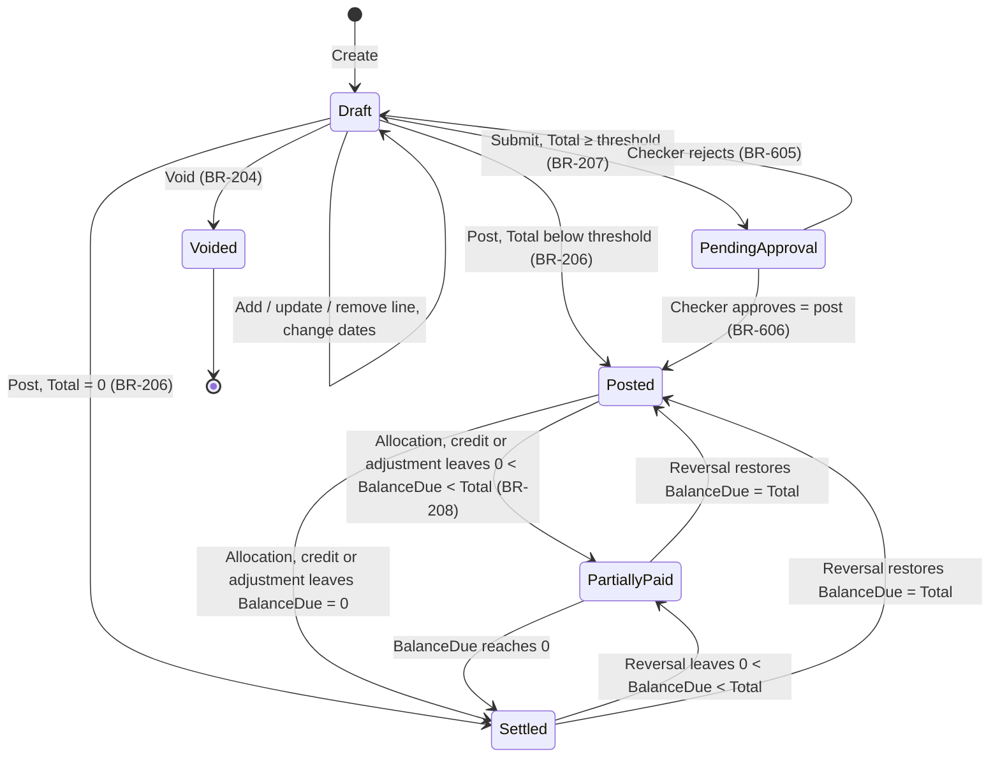

# Domain Model

- **Status:** R1 written 2026-09-29. Source of truth for rules is `requirements.md` (BR-nnn); this
  document says how those rules are expressed as aggregates, value objects, invariants and events.
  Storage is in `database.md`. Decisions are in `docs/adr/` (ADRs 0003–0010).
- **Domain:** hospital and clinic patient billing in India. R1 payers are self-pay only.

---

## 1. Ubiquitous language

| Term | Meaning |
|---|---|
| **Tenant** | One hospital or clinic; the unit of isolation. Every record below belongs to one tenant. |
| **Patient** | The person who received care. Identified within the tenant by MRN. |
| **Payer** | The party that owes money. In R1 always `SelfPay`: the patient themselves or a guarantor. |
| **Bill** | The document that charges a payer for services rendered to a patient. Has lines. Replaces the generic word "invoice". |
| **Payment** | Money received from a payer. Posted when recorded. Replaces "receipt". |
| **Allocation** | Applying part of a payment (or of a credit note's available credit) to a bill. |
| **Unapplied cash** | The part of a payment not yet allocated to any bill. |
| **Credit note** | A document that reduces what a payer owes on a bill; excess becomes **available credit**. |
| **Adjustment** | A document that reduces a bill's balance without money moving: discount, write-off, rounding. |
| **Refund** | Money returned to a payer from unapplied cash or available credit. |
| **Posting** | The act that makes a document financially effective: number, ledger entries, cache updates, audit, in one transaction. |
| **Ledger** | The receivables subledger: double-entry lines that are the source of truth for every balance. |
| **Cached balance** | A denormalised figure (`Bill.BalanceDue`, `Payment.UnappliedAmount`, `CreditNote.AvailableAmount`, `PayerBalance`) that must always equal a ledger sum (BR-404). |
| **Maker / Checker** | The user who requests a sensitive action and the different user who approves it (BR-603). |
| **Business date** | A calendar date in IST on a document (bill date, payment date). Distinct from the UTC instant when it was recorded (BR-003). |
| **Fiscal year** | 1 April – 31 March, labelled `2026-27` (BR-004). |

---

## 2. Module map

| Module | Aggregates / entities | Value objects and services | Notes |
|---|---|---|---|
| **Common** | `ApprovalRequest`, `NumberSeries` | `Money`, `UnitPrice`, `Quantity`, `Percent`, `FiscalYear`, `DocumentNumber`, typed ids (the `ITypedId` contract, and `TenantId` and `UserId`, which every module needs), the base types `Entity<TId>`, `AggregateRoot<TId>`, `ITenantScoped`, `ICreationAudited`, `IModificationAudited`, `IHasRowVersion` (ADR 0015), `IClock`, `IUnitOfWork`, `ITenantContext`, `ICurrentUser`, `INumberSeries`, `IIdempotencyStore`, `Result<T>`, `Error` | Cross-cutting; usable by every module. |
| **Identity** | `Tenant`, `User` (with roles) | `Role` | JWT issuance and validation live in Infrastructure/Api. |
| **Payers** | `Patient`, `Payer` | `Mrn`, `PayerKind` | Reference data with lifecycle by status (BR-102, BR-105). |
| **Billing** | `Bill` + `BillLine`, `CreditNote` + `CreditNoteLine` + `CreditNoteAllocation`, `ServiceItem` | `BillNumber`, `CreditNoteNumber` | Publishes `IBillReadService` (bill balances) for Payments and Adjustments. |
| **Payments** | `Payment` + `PaymentAllocation`, `Refund` | `PaymentNumber`, `RefundNumber`, `PaymentMethod` | |
| **Receivables** | `LedgerPosting` + `LedgerEntry` (append-only), `PayerBalance` (cache) | `LedgerAccount`, `IReceivablesLedger` | Owns the posting templates and the reconciliation query. |
| **Adjustments** | `Adjustment` | `AdjustmentNumber`, `AdjustmentKind` | |
| **Reporting** | none (read models / queries) | | Reads any module's tables through query services; never writes. |
| **Audit** | `AuditRecord` (append-only) | `IAuditWriter` | Subscribes to every domain event. |

Cross-module rule (CLAUDE.md §3): a module touches another module's data only through that module's
Application contracts. Payments never loads `Bill` through a `DbSet`; it calls Billing's
`IBillRepository`/`IBillReadService`. The Receivables ledger is written only through
`IReceivablesLedger`.

---

## 3. Value objects

All value objects are immutable `record` or `readonly record struct` types in `BillingRecon.Domain.Common`
unless stated. Construction validates; an invalid value cannot exist.

| Type | Definition | Rules |
|---|---|---|
| `Money` | `readonly record struct Money(decimal Amount)`; INR only; scale exactly 2. | `Money.Of(decimal)` requires scale ≤ 2 (a bug otherwise). `Money.Round(decimal raw)` rounds `AwayFromZero` to 2 places and is the **only** way to turn a computed value into money (BR-001). `+`, `-`, comparisons, `Zero`, `IsZero`, `IsNegative`. There is no `*` operator: multiply the raw decimals, then `Money.Round`. |
| `UnitPrice` | `decimal` with scale 4, `≥ 0`. | BR-201. Stored as `decimal(19,4)`. |
| `Quantity` | `decimal` with scale 3, `> 0`. | BR-201. Stored as `decimal(9,3)`. |
| `Percent` | `decimal` with scale 2, `0 ≤ value ≤ 100`. | Tax rates (BR-201). |
| `FiscalYear` | `(int StartYear)`; `Label` = `"2026-27"`; `Start` = 1 Apr, `End` = 31 Mar. | `FiscalYear.FromDate(DateOnly)`: month ≥ 4 → same year, else previous year (BR-004). |
| `DocumentNumber` | `(DocumentType Type, FiscalYear Year, string Prefix, int Sequence)`; `ToString()` = `PREFIX/YY-YY/NNNNNN`, for example `BIL/26-27/000123` (≤ 16 characters, ADR 0008). | Only `INumberSeries` creates one, inside a posting transaction (BR-801). `BillNumber`, `CreditNoteNumber`, `PaymentNumber`, `AdjustmentNumber`, `RefundNumber` are thin typed wrappers so a bill number cannot be assigned to a payment. |
| Typed ids | `TenantId`, `UserId`, `PatientId`, `PayerId`, `ServiceItemId`, `BillId`, `BillLineId`, `CreditNoteId`, `PaymentId`, `AllocationId`, `AdjustmentId`, `RefundId`, `ApprovalRequestId`, `PostingId`, `CorrelationId` — each `readonly record struct X(Guid Value) : ITypedId`. | Prevents passing a `PaymentId` where a `BillId` is expected. The `Guid` is generated client-side (sequential) by EF when the entity is added to the context: the id is empty before that and known before anything is saved (ADR 0015). |
| `Mrn` | Non-empty, trimmed, ≤ 30 chars. | BR-101. |
| `PaymentMethod` | enum `Cash, Card, Upi, BankTransfer, Cheque`. | BR-301. |
| `PayerKind` | enum `SelfPay` (R1), `Insurer`, `Corporate` (reserved). | BR-103: only `SelfPay` is accepted in R1. |
| `AdjustmentKind` | enum `Discount, WriteOff, Rounding`. | BR-501. |
| `LedgerAccount` | enum `Receivable, UnappliedCash, CreditAvailable, Revenue, Cash, Adjustments`. | BR-403. |
| `DateOnly` | Used directly for business dates. | Always IST calendar dates (BR-003). |

Line arithmetic lives in one place, `LineCalculator` (Domain, Billing), used by `BillLine` and
`CreditNoteLine`:

```
LineAmount    = Money.Round(Quantity × UnitPrice)
TaxableAmount = LineAmount − DiscountAmount
TaxAmount     = Money.Round(TaxableAmount × TaxRate / 100)
LineTotal     = TaxableAmount + TaxAmount
```

Example (BR-202): 3 × ₹333.3333 → `LineAmount` 1000.00 (999.9999 rounds up), discount ₹0.50 →
taxable 999.50, GST 5% → tax `Money.Round(49.975)` = **49.98** (away from zero, not banker's 49.98/49.97
ambiguity), `LineTotal` 1049.48. Totals are sums of these, never rounded again (BR-203).

---

## 4. Aggregates

Conventions for every aggregate root: `TenantId` (BR-002, `ITenantScoped`), typed `Id`
(`AggregateRoot<TId>`), `RowVersion` concurrency token (BR-804, `IHasRowVersion`), and the audit
columns `CreatedAtUtc` / `CreatedByUserId` and `UpdatedAtUtc` / `UpdatedByUserId`
(`ICreationAudited`, `IModificationAudited`). The tenant, the id and the audit columns are filled by
the persistence layer from `ITenantContext`, `ICurrentUser` and `IClock`; an aggregate never assigns
them (ADR 0015). `Tenant` itself is the exception: it is not tenant-scoped (a tenant sees and writes its own row
only, ADR 0015) and has `CreatedAtUtc`
only. Roots expose behaviour methods that return `Result` for business failures; they never throw
for expected cases. Roots raise domain events (§8) that the unit of work dispatches before commit;
an event must not copy the aggregate's id inside a factory method, where the id is still empty.

### 4.1 Patient (Payers module)

| | |
|---|---|
| **Root** | `Patient` |
| **Fields** | `Mrn`, `FullName`, `DateOfBirth?`, `Sex?`, contact and address fields, `Status` (`Active`, `Inactive`) |
| **Commands** | `Register`, `UpdateDemographics`, `Deactivate`, `Reactivate` |
| **Invariants** | MRN unique per tenant (BR-101, enforced by unique index and checked in the use case). Never deleted (BR-102). `Inactive` patients cannot be billed (checked by `Bill.Create`). |
| **Events** | `PatientRegistered`, `PatientDeactivated` |

### 4.2 Payer (Payers module)

| | |
|---|---|
| **Root** | `Payer` |
| **Fields** | `Kind` (`SelfPay`), `Name`, `PatientId?` (the patient this self-pay payer *is*), contact fields, `Status` |
| **Commands** | `CreateSelfPay(patient?)`, `Update`, `Deactivate`, `Reactivate` |
| **Invariants** | `Kind == SelfPay` in R1 (BR-103). At most one payer per `PatientId` (BR-104, filtered unique index). Never deleted; inactive payers receive no new bills, payments or refunds (BR-105, BR-309). |
| **Events** | `PayerCreated`, `PayerDeactivated` |

`PayerBalance` is **not** part of this aggregate. It is a Receivables cache keyed by `PayerId` (§4.10).

### 4.3 ServiceItem (Billing module, reference data)

Chargemaster entry: `Code` (unique per tenant), `Name`, `Category?`, `DefaultUnitPrice`,
`TaxRate`, `IsActive`. A bill line may copy price and tax rate from it; the line keeps its own copy so
later price changes never alter a bill. Deactivated, never deleted.

### 4.4 Bill + BillLine (Billing module)

| | |
|---|---|
| **Root** | `Bill` |
| **Children** | `BillLine` (`LineNo`, `ServiceItemId?`, `Description`, `Quantity`, `UnitPrice`, `DiscountAmount`, `TaxRate`, computed `LineAmount`, `TaxAmount`, `LineTotal`) |
| **Fields** | `Number?` (null until posted), `FiscalYear?`, `PatientId`, `PayerId`, `BillDate`, `DueDate`, `EncounterReference?`, `Notes?`, `Status`, `SubTotal`, `DiscountTotal`, `TaxTotal`, `Total`, `BalanceDue`, posted/voided stamps |
| **Commands** | `Create`, `AddLine`, `UpdateLine`, `RemoveLine` (draft only), `ChangeDates`, `Void`, `SubmitForApproval`, `Post(number, clock, user)`, `ApplyCredit(amount)` / `RestoreBalance(amount)` (called only by posting use cases, see §6) |
| **Invariants** | Lines per BR-201; arithmetic per BR-202; totals per BR-203; at least one line to post. Draft-only editing and voiding (BR-204). Dates per BR-205. `Number` present iff posted (BR-206). Frozen after posting (BR-006, BR-209): every mutating method returns `Error(bill_already_posted)` once `Status ∉ {Draft, PendingApproval}`. `0 ≤ BalanceDue ≤ Total` (BR-405). Status follows balance (BR-208). Threshold approval (BR-207). Patient and payer active at creation (BR-102, BR-105). |
| **Events** | `BillPosted`, `BillVoided`, `BillSubmittedForApproval`, `BillBalanceChanged` |

State machine: §5.

### 4.5 CreditNote + CreditNoteLine + CreditNoteAllocation (Billing module)

| | |
|---|---|
| **Root** | `CreditNote` |
| **Children** | `CreditNoteLine` (as `BillLine`, plus `BillLineId?`); `CreditNoteAllocation` (`BillId`, `Amount`, `Status`, posting refs) |
| **Fields** | `Number?`, `FiscalYear?`, `BillId`, `PayerId`, `PatientId`, `CreditNoteDate`, `Reason`, `Status` (`Draft`, `PendingApproval`, `Posted`, `Voided`), totals, `AvailableAmount` |
| **Commands** | `Create(bill)`, line edits (draft only), `SubmitForApproval`, `Post` (checker), `Void`, `Apply(bill, amount)`, `ReverseApplication(allocation)` |
| **Invariants** | Against one posted bill of the same payer; `Σ posted credit note totals ≤ Bill.Total` (BR-210, checked at posting through `IBillReadService`). Referenced line cap (BR-211). Maker-checker (BR-212, BR-604). At posting: `AvailableAmount = Total`, then auto-apply `min(Total, Bill.BalanceDue)` to its bill. `0 ≤ AvailableAmount ≤ Total` (BR-213, BR-405). `CreditNoteDate ≥ Bill.BillDate` (BR-214). Frozen after posting (BR-006). |
| **Events** | `CreditNotePosted`, `CreditApplied`, `CreditApplicationReversed`, `CreditNoteVoided` |

### 4.6 Payment + PaymentAllocation (Payments module)

| | |
|---|---|
| **Root** | `Payment` |
| **Children** | `PaymentAllocation` (`BillId`, `Amount`, `Status` (`Active`, `PendingReversal`, `Reversed`), allocated/reversed stamps, `PostingId`, `ReversalPostingId?`) |
| **Fields** | `Number`, `FiscalYear`, `PayerId`, `PaymentDate`, `Method`, `Reference?`, `Amount`, `UnappliedAmount`, `Status` (`Posted`, `PendingReversal`, `Reversed`), reversal stamps |
| **Commands** | `Record(...)` (creates *and* posts, BR-302), `Allocate(bill, amount)`, `RequestAllocationReversal`, `ReverseAllocation` (checker), `RequestReversal`, `Reverse` (checker) |
| **Invariants** | `Amount > 0`; reference required unless Cash; date per BR-205 (BR-301). Payer active (BR-309). Allocation caps: `0 < amount ≤ UnappliedAmount` and `≤ Bill.BalanceDue`, same payer (BR-303). `0 ≤ UnappliedAmount ≤ Amount` (BR-405). Reversal only if no refund was posted from it (BR-306); reversal reverses active allocations first. `Reversed ⇒ UnappliedAmount = 0`. Financial fields frozen from creation (BR-006). |
| **Events** | `PaymentRecorded`, `PaymentAllocated`, `AllocationReversed`, `PaymentReversed` |

### 4.7 Refund (Payments module)

| | |
|---|---|
| **Root** | `Refund` |
| **Fields** | `Number?`, `FiscalYear?`, `PayerId`, `SourceKind` (`Payment` or `CreditNote`), `SourcePaymentId?` / `SourceCreditNoteId?` (exactly one), `RefundDate`, `Amount`, `Method`, `Reference?`, `Reason`, `Status` (`Draft`, `PendingApproval`, `Posted`, `Voided`) |
| **Commands** | `Draft`, `SubmitForApproval`, `Post` (checker), `Void` |
| **Invariants** | `Amount > 0` and `≤ source available amount at posting` (BR-307). Exactly one source. Maker-checker (BR-604). Not reversible (BR-308). Payer active (BR-309). |
| **Events** | `RefundPosted`, `RefundVoided` |

### 4.8 Adjustment (Adjustments module)

| | |
|---|---|
| **Root** | `Adjustment` |
| **Fields** | `Number?`, `FiscalYear?`, `BillId`, `PayerId`, `AdjustmentDate`, `Kind`, `Amount`, `Reason`, `Status` (`Draft`, `PendingApproval`, `Posted`, `Voided`) |
| **Commands** | `Draft`, `SubmitForApproval`, `Post` (checker), `Void` |
| **Invariants** | One posted bill; `0 < Amount ≤ Bill.BalanceDue` at posting; `Rounding < 1.00` (BR-501). Reason required; maker-checker (BR-502). Reduces only (BR-503). |
| **Events** | `AdjustmentPosted`, `AdjustmentVoided` |

### 4.9 ApprovalRequest (Common module)

| | |
|---|---|
| **Root** | `ApprovalRequest` |
| **Fields** | `DocumentType`, `DocumentId`, `Action` (`Post`, `Reverse`, `ChangePrefix`), `MakerUserId`, `MakerComment?`, `CheckerUserId?`, `CheckerComment?`, `Status` (`Pending`, `Approved`, `Rejected`), `RequestedAtUtc`, `DecidedAtUtc?`, `CorrelationId` |
| **Commands** | `Open(maker)`, `Approve(checker)`, `Reject(checker, comment)` |
| **Invariants** | `CheckerUserId ≠ MakerUserId` (BR-603; also a CHECK constraint). Checker holds Supervisor or TenantAdmin (checked by the use case from `ICurrentUser`). One pending request per document (BR-605; filtered unique index). Decision is final. |
| **Events** | `ApprovalRequested`, `ApprovalGranted`, `ApprovalRejected` |

The approval use case (`ApproveRequestHandler`) loads the request and the target document, calls the
document's `Post`/`Reverse`, and commits everything in one transaction (BR-606). The request itself
never carries financial data.

### 4.10 LedgerPosting + LedgerEntry, PayerBalance (Receivables module)

| | |
|---|---|
| **Root** | `LedgerPosting` (append-only) |
| **Children** | `LedgerEntry` (`LineNo`, `Account`, `SubjectType?`, `SubjectId?`, `PayerId?`, `Debit`, `Credit`) |
| **Fields** | `PostedAtUtc`, `BusinessDate`, `Kind`, `DocumentType`, `DocumentId`, `PayerId`, `ReversalOfPostingId?`, `Description`, `PostedByUserId`, `CorrelationId` |
| **Creation** | Only through `IReceivablesLedger.PostAsync(PostingTemplate, ct)`, which builds the lines from the templates in `database.md` §5.3, asserts `Σ Debit = Σ Credit` (BR-401), writes the entries and applies the cache deltas to `PayerBalance` in the same transaction (BR-404). |
| **Invariants** | Balanced; two or more lines; each line has exactly one of Debit/Credit > 0; subject rules per BR-403; never updated or deleted (BR-402). |

`PayerBalance` (`PayerId`, `Receivable`, `UnappliedCash`, `CreditAvailable`, computed
`NetOutstanding`) is a cache row updated by atomic set-based increments inside the posting
transaction. It has no rowversion and is never edited by hand; drift is detected by the
reconciliation query (BR-404).

### 4.11 NumberSeries (Common module)

`(TenantId, DocumentType, FiscalYear)` → `Prefix`, `NextNumber`. `INumberSeries.NextAsync(type,
fiscalYear, ct)` runs inside the caller's transaction, locks the row (`UPDLOCK, HOLDLOCK`), creates it
on first use with the tenant's default prefix, increments it and returns a `DocumentNumber` (BR-801,
BR-802). Prefix changes go through `ApprovalRequest` with `Action = ChangePrefix`.

### 4.12 Tenant and User (Identity module)

`Tenant`: `Code`, `Name`, `Status`, settings (`PostingApprovalThreshold?`, `MaxBackdateDays`,
`DefaultDueDays`, default prefixes per document type). Settings changes are audited (BR-607).
Built so far: `Tenant.Create(code, name, createdAtUtc)`, which returns a validation failure
(`tenant_invalid`, with messages per field) unless the code is 1–20 lower-case letters, digits and
single hyphens and the name is 1–200 characters, and which sets the initial settings (active, no
threshold, 7 days of back-dating, due on the bill date, prefixes `BIL`, `CN`, `PAY`, `ADJ`, `REF`).
The threshold is a plain decimal until `Money` exists. Changing settings and suspending arrive with
the Identity slice.
`User`: `Email` (unique per tenant), `DisplayName`, `PasswordHash`, `Status`, `Roles`. JWT issuance
is an Infrastructure concern; the Domain only knows roles (BR-601, BR-602).

### 4.13 AuditRecord (Audit module)

Append-only: `OccurredAtUtc`, `UserId?`, `CorrelationId`, `EntityType`, `EntityId`, `DocumentNumber?`,
`Action`, `BeforeJson?`, `AfterJson?`, `Reason?`. Written by `IAuditWriter` from domain events and from
explicit calls in use cases, always inside the unit of work (BR-701, BR-702).

---

## 5. State machines

### 5.1 Bill



- `Draft` and `PendingApproval` are the only states with editable content; `PendingApproval` is
  locked for editing but has no number and no ledger effect.
- `Posted`, `PartiallyPaid` and `Settled` are one family: the bill is financially frozen (BR-006) and
  the status is a pure function of `BalanceDue` versus `Total` (BR-208). There is no `Cancelled` state
  for a posted bill; a full credit note takes it to `Settled`.

### 5.2 Credit note, adjustment, refund (maker-checker documents)

```
Draft ──Submit──▶ PendingApproval ──Approve──▶ Posted
  │                     │
  │◀──────Reject────────┘
  └──Void──▶ Voided
```

`Posted` is terminal (BR-006). Reversals of these documents are out of scope in R1 (BR-308; a
posted credit note or adjustment is corrected by a new bill).

### 5.3 Payment and allocations

```
Payment:     Posted ──RequestReversal──▶ PendingReversal ──Approve──▶ Reversed
                ▲                              │
                └──────────Reject──────────────┘

Allocation:  Active ──RequestReversal──▶ PendingReversal ──Approve──▶ Reversed
                ▲                              │
                └──────────Reject──────────────┘
```

A payment in `PendingReversal` cannot be allocated or refunded; a `Reversed` payment has
`UnappliedAmount = 0` and all its allocations `Reversed` (BR-306).

### 5.4 ApprovalRequest

`Pending → Approved | Rejected`, decided once, by a user other than the maker (BR-603).

---

## 6. Transaction boundaries and the allocation exception

**Default rule.** A use case commands **one document aggregate** and commits **one unit of work**
(BR-007). Ledger entries, the `PayerBalance` cache and audit records are written by services inside
that same unit of work; they are consequences of the command, not separate aggregates being
commanded.

**The exception: allocation commands two aggregates.** `AllocatePaymentHandler` loads both the
`Payment` and the `Bill`, validates BR-303 against both (`amount ≤ Payment.UnappliedAmount` and
`amount ≤ Bill.BalanceDue`), calls `payment.Allocate(bill.Id, amount)` and `bill.ApplyCredit(amount)` (the aggregates take ids, never
each other: ADR 0003, amendment of 2026-10-17),
posts the paired ledger entry `Dr UnappliedCash(payment) / Cr Receivable(bill)`, and saves both
under **both** rowversions. If either rowversion is stale the whole transaction fails with 409
`concurrency_conflict` (BR-804).

Why this is allowed rather than avoided:

1. The two caps are invariants of two aggregates *at the same instant*. Checking them in memory is
   the only way to return a `Result` failure (`allocation_exceeds_unapplied`,
   `allocation_exceeds_balance_due`) instead of an opaque CHECK-constraint exception.
2. Both cached balances derive from the **same** ledger posting (§4.10). Updating one without the
   other would violate BR-404 between two commits; there is no consistent intermediate state.
3. There is no queue or eventual consistency in this system (CLAUDE.md §2, banned), so "update the
   bill later" is not an option.

The same pattern (document aggregate + `Bill`) is used wherever a posting reduces a bill's balance:

| Use case | Aggregates loaded and saved | Ledger pair |
|---|---|---|
| Allocate payment / reverse allocation | `Payment`, `Bill` | `UnappliedCash(payment)` ↔ `Receivable(bill)` |
| Post credit note (auto-apply) / apply credit / reverse application | `CreditNote`, `Bill` | `CreditAvailable(creditNote)` ↔ `Receivable(bill)` |
| Post adjustment | `Adjustment`, `Bill` | `Adjustments` → `Receivable(bill)` |
| Post refund | `Refund`, `Payment` **or** `CreditNote` | `UnappliedCash` / `CreditAvailable` → `Cash` |
| Reverse payment | `Payment`, every `Bill` with an active allocation | N mirror pairs, then `UnappliedCash` → `Cash` |
| Approve any request | `ApprovalRequest` + the document (and its `Bill` where applicable) | as above |

`PayerBalance` is deliberately **not** loaded as an aggregate: it is updated with an atomic
`UPDATE … SET Receivable += @delta` so that concurrent postings for the same payer never conflict on
a rowversion. Correctness of that cache is guaranteed by the reconciliation query, not by locking.

Database CHECK constraints (`BalanceDue BETWEEN 0 AND Total`, `UnappliedAmount BETWEEN 0 AND
Amount`) are the last line of defence behind these in-memory checks, never the first.

---

## 7. Posting: what "one transaction" contains

For every posting use case, the unit of work commits exactly these writes together (BR-007):

1. The document's status and stamps (`Post`, `Reverse`) and, for new postings, its number from
   `INumberSeries` (BR-801). The number is requested **after** all validation has passed, so the
   series row is locked for the shortest possible time.
2. The `LedgerPosting` with its balanced entries (BR-401).
3. The cache updates: the document's own cache field, the `Bill` it touches (§6), and the
   `PayerBalance` increments (BR-404).
4. The `ApprovalRequest` decision, where the action needed one (BR-606).
5. The `AuditRecord` rows for every entity that changed (BR-701).
6. The idempotency record's completion with the response (BR-803, ADR 0006).

A failure at any step rolls back all six. Integration tests inject a failure after step 2 and assert
that no number was consumed and no rows exist (US-25).

---

## 8. Domain events

Events are immutable records in `BillingRecon.Domain.<Module>`, raised by aggregate methods and
collected on the root. The unit of work dispatches them **in-process, synchronously, before
`SaveChanges`**, so handlers (audit, reporting projections) join the transaction. There is no outbox
and no broker in R1 (CLAUDE.md §2); R5 may add an outbox for external integrations.

| Event | Raised by | Payload (beyond ids and tenant) | Consumers |
|---|---|---|---|
| `PatientRegistered`, `PatientDeactivated` | `Patient` | MRN | Audit |
| `PayerCreated`, `PayerDeactivated` | `Payer` | kind, name | Audit (the zero `PayerBalance` row is created by the Payers use case through a Receivables port, not by a subscriber: ADR 0003, amendment of 2026-10-17) |
| `BillSubmittedForApproval` | `Bill` | total, maker | Audit (the `ApprovalRequest` is opened by the Billing use case through the approval port of Common, not by a subscriber) |
| `BillPosted` | `Bill` | number, payer, total, business date | Audit |
| `BillVoided` | `Bill` | reason | Audit |
| `BillBalanceChanged` | `Bill` | old and new balance, cause | Audit |
| `CreditNotePosted` | `CreditNote` | number, bill, total, applied amount | Audit |
| `CreditApplied`, `CreditApplicationReversed` | `CreditNote` | bill, amount | Audit |
| `PaymentRecorded` | `Payment` | number, payer, method, amount | Audit |
| `PaymentAllocated`, `AllocationReversed` | `Payment` | bill, amount | Audit |
| `PaymentReversed` | `Payment` | reason, reversed allocations | Audit |
| `RefundPosted` | `Refund` | number, source, amount | Audit |
| `AdjustmentPosted` | `Adjustment` | number, bill, kind, amount | Audit |
| `ApprovalRequested`, `ApprovalGranted`, `ApprovalRejected` | `ApprovalRequest` | document, maker, checker, comment | Audit |
| `NumberSeriesPrefixChanged` | `NumberSeries` | old and new prefix | Audit |
| `TenantSettingsChanged`, `UserCreated`, `UserRolesChanged`, `UserDisabled` | `Tenant`, `User` | before and after | Audit |

Ledger entries are **not** produced by event handlers: the posting use case calls
`IReceivablesLedger` directly so that the ledger write is explicit in the handler and cannot be
skipped by a mis-wired subscriber (BR-401). The same holds for every effect in another module:
`Audit` is the only subscriber, and it handles `IDomainEvent` generically, so no module depends on
another module's events (ADR 0003, amendment of 2026-10-17).

---

## 9. Domain services and Application ports

| Port (Application) | Responsibility | Implemented in |
|---|---|---|
| `IClock` | `UtcNow` (instant) and `TodayIst` (business date); the only time source (BR-003). | Infrastructure (`SystemClock`); tests use a fixed clock. |
| `ITenantContext`, `ICurrentUser` | Tenant and user from the validated JWT, resolved once per request (BR-002, BR-602). | Api middleware → Infrastructure. |
| `IUnitOfWork` | `CommitAsync(ct)`: dispatch domain events, save, commit the transaction (BR-007). | Infrastructure (EF Core `DbContext` + transaction). |
| `INumberSeries` | `NextAsync(type, fiscalYear, ct)` inside the current transaction (BR-801). | Infrastructure (raw SQL with `UPDLOCK, HOLDLOCK`, ADR 0008). |
| `IReceivablesLedger` | `PostAsync(template, ct)`: balanced entries + `PayerBalance` deltas (BR-401, BR-404). | Infrastructure (Receivables). |
| `IIdempotencyStore` | Reserve, complete and look up keys (BR-803, ADR 0006). | Infrastructure. |
| `IAuditWriter` | Append audit records (BR-701). | Infrastructure (Audit). |
| Repositories | `IPatientRepository`, `IPayerRepository`, `IBillRepository`, `ICreditNoteRepository`, `IPaymentRepository`, `IRefundRepository`, `IAdjustmentRepository`, `IApprovalRequestRepository`, `IUserRepository`, `ITenantRepository` — load by id (tenant-filtered), add, and nothing else. No `Remove` (BR-005). | Infrastructure. |
| Read services | `IBillReadService`, `IPayerReadService`, reporting queries. | Infrastructure (EF queries, `AsNoTracking`). |
| Domain services (Domain) | `LineCalculator` (BR-202), `FiscalYear.FromDate` (BR-004), `PostingTemplates` (the account pairs in `database.md` §5.3). | Domain. |

---

## 10. Open questions (to resolve before the corresponding slice is built)

1. Should tiny `Rounding` adjustments (< ₹1) be exempt from maker-checker to keep the cashier flow
   fast? Today BR-502 says no; a tenant setting `AutoApproveAdjustmentsBelow` would be an ADR.
2. Does a tenant need more than one bill series (for example per department)? BR-801 assumes one
   series per document type.
3. Whether `Sex` and address fields are needed for billing at all, or whether the HIS remains the
   only place for demographics and BillingRecon stores just MRN and name.
